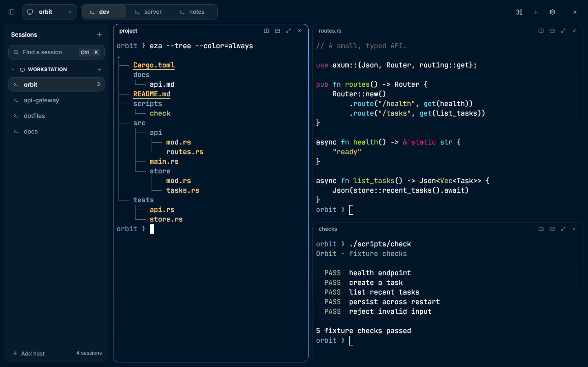

# Rex Linux

An unofficial, independent native Linux client for [Rex](https://www.superlogical.com/rex), the terminal multiplexer from Superlogical. It is not affiliated with, endorsed by or supported by Superlogical or the Rex authors.



Rex Linux attaches to an existing Rex server. Saved hosts contain sessions, each session's Rex windows become tabs, and the server defines the terminal splits. Sessions and their programs stay on the server when the app closes, so any other Rex client can attach to the same sessions.

It is written in Rust on [Rune](https://github.com/anomalyco/rune) (wgpu/winit, `rune-kit` components) with libghostty-vt for terminal emulation, and talks to the server through the [`rexrs`](https://github.com/a10y/rexrs) control SDK.

> **Status:** early. The protocol layer, workspace, terminal rendering and input are implemented and tested against real servers, but some areas (see [Current scope](#current-scope)) still need hands-on validation.

## Features

- **Settings → About** (also **About Rex Linux** in Commands) shows the app icon, version and how it was installed, the build commit and date, and for the active host, when connected, its Rex server's version, the negotiated API revision and the range of revisions the server supports. The server's version comes from one read-only `server.version` request on each connection (its status arrives with the session list); nothing is attached, created or changed, and a server that doesn't answer is shown as not reported rather than guessed. **Copy version info** copies the client version, commit, build date, build channel (`official`, `nix` or `source`), OS and architecture, and the server version and API revisions. **Copy debug info** adds the install channel, display server, desktop, interface theme and zoom, terminal font, and for each saved host its kind (Unix socket, HTTPS, SSH), connection state, API revision and server version. Both are in Commands too, and neither contains a host name, address, session name, client id or credential. Open the repository, this version’s release notes, the MIT license or the issue tracker from the same page. Source archives without Git show `unknown` for build metadata.
- **In-app update notice and Settings → Updates:** official and Nix builds check the signed GitHub release manifest (`latest.json` and `latest.json.minisig`) against embedded CI and backup Minisign public keys about 30 seconds after launch and at most once every 24 hours while running. When a newer stable release is verified, a non-blocking toast offers **What's new** (opening the GitHub release page in your browser), **Updates…** and **Dismiss for this version**. Guidance matches the detected install channel (`REX_LINUX_CHANNEL`, `/usr/share/rex-linux/channel` and `~/.local/share/rex-linux/install.json`): `sudo pacman -Syu rex-linux-bin` on Arch (`omarchy update` on Omarchy), the verified `install.sh` one-command upgrade for tarball/script installs, `.deb` upgrade instructions for Debian/Ubuntu, and `nix flake update rex-rune` / `nix profile upgrade rex-linux` for Nix. Source builds never check automatically; turn automatic checks off in Settings → Updates (`updates.check` in `workspace.json`) or with `REX_LINUX_NO_UPDATE_CHECK=1`, or check on demand with **Check now** or `rex-linux --check-update`. Background check failures are silent, and the client never self-updates or downloads binaries.

- Multiple saved hosts, each with its sessions; session windows are tabs and splits follow the server's layout.
- Unix-socket, HTTPS/WSS and SSH endpoints. Add host lists the machines on your tailnet: a server that answers shows its reachable endpoint and, on API 12, a review of its listener addresses and access rules before connecting. Other machines take an SSH user name and are reached by forwarding their Rex socket over SSH (Tailscale SSH needs no keys).
- A single toolbar with session identity, tabs, commands and the window's own controls. A tab with one pane draws it edge to edge; splits are rounded pane cards. Tabs close from their right-click menu, a middle-click or `Ctrl Shift W`, always behind a confirmation; the same menu renames a tab, mutes it, moves it left or right in its session's order and closes the other tabs. Host-grouped session navigation opens on demand, with an optional sidebar (Ctrl Shift B) that opens at launch as it was left. Tabs can sit in the toolbar or, while the sidebar is open, under each session in the sidebar.
- Searchable session switcher (`Ctrl K`) and command palette (`Ctrl Shift P`). Commands lists every command under Session, Tab, Pane, Host, View, Appearance and App headings that name what is on screen, about twenty rows at a time, each with its current shortcut; typing searches commands, sessions and the current session's tabs as one list, and from two letters on the window colours and terminal themes whose names have a word starting with what was typed, under Appearance: Return on one applies it, and the one in use is checked. Among them: Next and Previous session, Refresh sessions, Close session…, the pane menu's rows for the focused pane (Copy selection, Paste, Select all, the splits, Copy pane ID, Clear terminal, Reset terminal), Find next and Find previous, Collapse other hosts, Change theme… (the terminal theme switcher, also the `client.theme.choose` action, which has no default key) and Change window colours…, compact or comfortable panes, Reveal pane headers, tabs in the sidebar or toolbar, interface zoom and terminal font size, About Rex Linux, Copy version info, Copy debug info, **Report an issue** and **Rex help**, which opens this guide for the installed version in your browser. The rows that end something (Close…, Remove…) come last in their group, in red. A host's own actions (those its Rex configuration defines with `rex.action`, and its block types' titled actions) are listed under Server actions when they need no arguments.
- Splits on any side of a pane (right, left, down, up) or along its longer side (best fit), and focus that moves by direction or cycles through a tab's panes.
- A window title of `<tab> - <session> · <host>`, so a task switcher can tell windows apart.
- Snapshot restore, live output, physical-layout key press and release forwarding with dead-key composition, bracketed paste, text selection and copy, local scrollback, and mouse/wheel reporting for terminal programs. Right-click always opens the pane menu, which starts with Copy (when text is selected), Paste and Select all for the pane under the pointer; Shift+right-click sends the click to a program that tracks the mouse, and Shift with the left button selects text locally.
- Terminal search (`Ctrl Shift F`) over the focused pane's screen and scrollback, with Ghostty's search. A bar over the terminal's top-right corner holds the field, the selected match's place among all matches (`2/5`, or "No matches"), and Find next, Find previous and Close buttons; the two arrows wait while there is nothing to step through. Every match is marked in the chrome's accent, and the selected one more strongly, with dark text. Enter or Find next (the up arrow) selects the next older match and Shift+Enter or Find previous (the down arrow) the next newer one, scrolling it into view; Escape or Close ends the search. The bar never hides the selected match: when that match is under it, the bar moves to another corner of the pane (the bottom-right first) and stays there until a selected match is under it again or the search is closed. It floats over the terminal and never resizes it. Find next and Find previous are also Commands rows and actions (`client.search.next`, `client.search.previous`, no default keys) that step while the keyboard is in the terminal; with the bar closed they bring it back on the last text searched in that pane, at its newest match, and leave the keyboard with the program (`Ctrl Shift F` moves it to the field). In a pane showing fewer rows than the terminal has, the view follows the selected match. New output is searched as it arrives, and the search survives a reconnect. Known limit: once a terminal restored from a snapshot has been resized, Ghostty can start from an older match and step toward newer ones; every match is still reached.
- Cursor shapes programs choose with DECSCUSR (block, bar or underline) in the focused pane; other panes show a hollow block. Blinking cursors draw steadily: terminal content does not animate.
- Underline styles (single, double, curly, dotted and dashed) and colours that programs set with SGR 4:x and 58, and overlines (SGR 53).
- Box-drawing and block element characters (U+2500–U+259F) are drawn as shapes on whole device pixels, as Ghostty draws them, rather than from the font, so borders, tables and block graphics meet their neighbours without seams or overlaps at any font or display scale.
- Inline Kitty graphics (RGB, RGBA and PNG), including image-bearing snapshots on reattach. Ghostty resolves placement, crop and paint order; the client caches decoded pixels and textures. Image storage is capped at 64 MiB per terminal. File, temporary-file and shared-memory image media are disabled: remote terminal output cannot read local files.
- Synchronized output (mode 2026): while a program holds an update open (for up to a second, as in Ghostty) the pane keeps its last frame, so full-screen programs redrawing after a resize don't flash blank.
- Links: Ctrl+click opens an `http`, `https`, `ftp` or `mailto` link with `xdg-open`, whether it is an OSC 8 hyperlink or a URL in the text (including one that soft-wraps across rows). Holding Ctrl over a link underlines it, shows a hand pointer and, after a moment, a tooltip naming its real target, so OSC 8 text cannot disguise where it goes. Ctrl+click works over programs that track the mouse too; clicks elsewhere still go to the program. Other schemes, `file://` among them, are never opened, since output may come from a remote host.
- Reconnect handling: a transport failure pauses input on affected panes (input is never replayed) while parsed output survives reconnects and session changes. TCP connections are probed when idle, so a server that dropped this client while the network was gone (a laptop asleep, for example) is noticed within about 30 seconds and the host and its terminals reconnect.
- Program activity on tabs. Programs that report their status with OSC 7501 (coding agents, for example) mark their tab with a word when they need you ("Needs approval", "Question", "Needs sign-in", "Needs input") or fail ("Error"), and with "Done" when they finish in a tab you weren't looking at. A terminal bell that rings out of sight marks its tab "Bell" until you see it. Progress that programs report with OSC 9;4 draws as a thin bar under the tab's label (and under a split pane's name) until they clear it or leave the foreground, with "Paused" (and its percentage, if it gave one) or "Error" as a word when the report says so; a working program's OSC 7501 percentage draws the same way when it sends no OSC 9;4. In a split, each pane's header carries its own word, so you can see which pane needs you. Each tab shows its focused pane's program icon (Claude Code, Codex, OpenCode, Pi and OMP, Vim, Git, Cargo, SSH; otherwise `>_`), and a tab or pane you haven't renamed takes the title its program sets (OSC 0 or 2), as a terminal window would, without changing its name on the server. Needs a server with API revision 8.
- Desktop notifications through the freedesktop notification service when a tab you aren't looking at needs you, fails or finishes, and for notifications programs send themselves (OSC 9 and OSC 777). Clicking one raises the window and shows that tab. Each kind can be turned off in Settings → Notifications, and **Mute tab** in a tab's menu keeps one tab quiet: no activity word or progress bar on it and no desktop notification from it, on this client only, until it is unmuted or closed.
- Agent integrations (Settings → Integrations): installs, updates or removes Rex's skill and session hooks for Claude Code, Codex, OpenCode, Pi and OMP on this machine with the local `rex skill` command. OMP reads the shared `~/.agents/skills/rex` skill used by Codex, OpenCode and Pi; it does not have a Rex session hook. `rex skill` has no OMP agent yet, so until it does, OMP's row changes Pi's skill: installing or removing it for one does the same for the other. Each agent's row shows its state as a chip (Installed, Update available, Not installed, Not found, Conflict or Unreadable) beside the actions that state allows, and a skill several agents share is noted once under the list. Every change is previewed with a dry run first, including every agent affected by that shared skill. "Let agents name sessions" is passed to every setup explicitly.
- Interface zoom (70–150%) and a configurable terminal font and size; Commands' Increase, Decrease and Reset terminal font size change the size without touching interface zoom, and can be given keys in `shortcuts.json`. Settings → Interface → Customize panes → Pane padding sets the space around every pane's content (0–32 pt, default 8 pt), including zero, with no restart.
- Chrome palettes (Settings → Themes → Window colours): **Midnight** (the default), **Rosé Pine**, **Rosé Pine Moon** and **Gruvbox Dark**, all dark, applied at once without restarting. Each pairs with a built-in terminal theme of the same name whose background is the chrome's ground. Until you pick a terminal theme yourself, choosing a palette moves the terminal theme from Follow server to **Follow chrome**, which declares the palette's paired theme to the server as below; a terminal theme you picked is left alone.
- Terminal themes (Settings → Themes, or Change theme… in Commands). Settings → Themes is a library of every theme this client can declare, each as a card in the theme's own colours: its background, `Aa` in its text colour, a `~/` chip in its selection colours, its cursor, and palette colours 0 to 7 as eight dots. Cards are grouped under Default (Follow server, Rex default colours, Follow chrome), Built in, Custom (your own Ghostty theme files), Ghostty dark and Ghostty light, and the card of the theme in use is marked. Pressing a card declares its theme at once and Settings stays open. The field over the grid searches names without case or accents (`rose` finds Rosé Pine), words in any order, and marks what matched; the arrows move among the cards, Return or Space chooses, and a letter typed on a card starts a search. The grid builds only the rows near the viewport, so a Ghostty install's six hundred themes scroll like ten. The Terminal theme row above the library, and Change theme… in Commands, open the switcher: a searched list, 340 pt wide and at most 420 pt tall, with the theme in use checked at the end of its row and each row's colours before the check as a strip of four dots (text, red, green and blue on the theme's background); its search works the same way. Opened from Settings it sits under its row and Settings stays open behind it; choosing a theme returns there. A card or a strip is a picture drawn from the theme's own colours and never recolours a terminal; a colour a theme leaves out is drawn as a pane shows it (the window's own background and selection, Rex's own text and palette). **Follow server**, the default, declares nothing and shows whatever colours the server has, as long as this client has never declared a theme. **Rex default colours**, **Follow chrome** (the chrome palette's paired theme), the built-in **Midnight**, **Rosé Pine**, **Rosé Pine Moon** and **Gruvbox Dark**, or any Ghostty theme file are declared to the server with Rex's `set_theme`, which the server applies to panes this client owns or nobody owns; while another client owns a pane, the server keeps that client's colours and applies ours when this client takes the pane. New tabs and splits are created with the theme. Ghostty themes are read from `$XDG_CONFIG_HOME/ghostty/themes` (default `~/.config/ghostty/themes`), then `$GHOSTTY_RESOURCES_DIR/themes`, then `ghostty/themes` under each `$XDG_DATA_DIRS` entry; the first file with a name wins. Selection and cursor-text colours from a theme are drawn by this client. Rex keeps this client's last theme for each pane across launches and applies it whenever this client owns the pane, so once this client has declared any theme (remembered as `terminal_theme_declared`, never cleared automatically), Follow server sends one empty `set_theme`, Rex's own colours, to each pane this client owns or nobody owns: once per pane per connection, when its stream starts, when this client takes it, and again after a reconnect. A server without `set_theme` is reported once and the choice is kept for other hosts.
- Borderless window with its own close button, edge resizing and drag region. There are no minimize or maximize buttons; double-clicking the drag region maximizes, and the window manager handles the rest.
- Keys are sent by physical position (Ghostty key names), so non-US layouts work.

**Attachment-only by default.** Attaching and reconnecting never start, stop, replace or reconfigure a Rex server and do not need a `rex` executable. A missing default server on an SSH host offers a separately confirmed, one-time **Start personal server…** action (see [SSH setup](#ssh-setup)); it never enables automatic starts on future connections. Settings → Integrations runs local `rex skill` with `--autostart=false`. Both explicit CLI features search `PATH`, then `$XDG_BIN_HOME` or `~/.local/bin` for desktop launches. An unavailable server is shown as disconnected and retried. Closing the client leaves server programs running.

## Install a binary release

### One-command user install or upgrade (0.5.2+)

```sh
curl --proto '=https' --tlsv1.2 -fsSL https://github.com/shuv1337/rex-rune/releases/latest/download/install.sh | sh
# Explicit upgrade, check, pin (including deliberate downgrade), or uninstall:
# ... | sh -s -- --upgrade
# ... | sh -s -- --check
# ... | sh -s -- --version 0.5.1
# ... | sh -s -- --uninstall
```

The signed, immutable release asset detects x86_64/aarch64 Linux and requires
**glibc 2.39+**, `curl`, `tar`, coreutils, `bash`, `desktop-file-utils`, and either
**minisign or OpenSSL 3+**. It verifies the signed checksums with embedded CI and
backup keys, verifies the tarball, then installs to `~/.local/bin` with a launcher
and icons. `XDG_BIN_HOME`, `XDG_DATA_HOME` and `XDG_CACHE_HOME` are respected.
No root, server changes or automatic downgrade. Uninstall keeps preferences.
NixOS users should use [Nix](docs/nix.md); musl is unsupported.

**Pipe-to-shell is trust on first use:** HTTPS and GitHub deliver the script you
execute. Its detached `install.sh.minisig` can be verified with a separately
trusted key before running a saved copy; retain that reviewed copy for upgrades.
The script's body runs only after the complete function has downloaded. Package
verification is mandatory; there is no unsigned mode. A saved script with old
keys fails closed after rotation. **Only** explicit `--trust-repo-keys` expands
trust to keys at the requested release's protected tag (never `master`), printing
the key ID and fingerprint. Prefer fetching and reviewing the current script.

`/usr/bin/rex-linux` or a mismatching install receipt blocks replacement;
`--force` deliberately overrides those guards, **not signature checks or downgrade
protection**. A receipt requires Python 3 to validate; pre-receipt installs such
as 0.5.1 upgrade without it. Avoid mixing user installs and package managers.

### Manual download

Download a package and `SHA256SUMS` from [Releases](https://github.com/shuv1337/rex-rune/releases). Choose **x86_64 / amd64** for Intel/AMD or **aarch64 / arm64** for ARM64. For signed releases, [verify the signature](#verify-a-download) before installing.

```sh
sha256sum --ignore-missing -c SHA256SUMS

# Debian/Ubuntu: install the one .deb matching your architecture.
sudo apt install ./rex-linux_0.6.0_amd64.deb

# Or extract the matching tarball and install for your user (no root).
tar -xzf rex-linux-0.6.0-x86_64-linux-gnu.tar.gz
cd rex-linux-0.6.0-x86_64-linux-gnu
bash install.sh
```

The tarball installs into `~/.local/bin` with a desktop launcher and icons, independently of any source checkout. It needs `desktop-file-utils`; uninstall with `bash scripts/install-desktop.sh --uninstall`. Uninstall a `.deb` with `sudo apt remove rex-linux`. Neither removes preferences or changes Rex servers. Avoid mixing both installation methods: a user installation can shadow `/usr/bin/rex-linux`.

Prebuilt packages are built on Ubuntu 24.04 and require **glibc 2.39+**. They are dynamically linked, not self-contained AppImages. Install your distribution's graphics drivers, fontconfig (including `fc-match`), xkbcommon, Wayland/X11, EGL/OpenGL/Vulkan libraries, CA certificates and `xdg-utils`. On Debian/Ubuntu the `.deb` declares these dependencies. Rust and Zig are **not** needed to run a binary. A running Rex server with API revision 10, 11, 12 or 13 is required.

### Verify a download

Releases from 0.5.0 include `SHA256SUMS.minisig`, `latest.json`, and
`latest.json.minisig`; from 0.5.2, `install.sh` and `install.sh.minisig` too.
Both release keys are configured; v0.4.2 and earlier remain unsigned. The CI public key is
committed as [`packaging/keys/release.pub`](packaging/keys/release.pub):

- Minisign key ID: `A1FD78C27652816E`.
- SHA-256 fingerprint (decoded 42-byte minisign public-key record):
  `9e779605311a46a5287d6c9b25eb2083fb17447454239c7d66f1ecebe336d0c6`.

The offline recovery public key is committed as
[`packaging/keys/release-backup.pub`](packaging/keys/release-backup.pub):

- Minisign key ID: `368EA1A12E2721F3`.
- SHA-256 fingerprint (decoded 42-byte minisign public-key record):
  `d9fe424ca8b20725e11d6039c39445d38a33023a8d366c69e0612a1c3528de76`.

See the [public-key registry](packaging/keys/README.md). Both public trust roots
are embedded in the client for signed release metadata checks (`latest.json`); tag publication still fails closed on missing secrets or invalid
signatures. The client never self-updates or downloads binaries.

For a signed release, obtain and retain a trusted copy of those public keys
separately from the downloaded assets. With `minisign` installed, and the package,
`SHA256SUMS` and `SHA256SUMS.minisig` from the **same release** in your directory:

```sh
# Stop if verification fails. For a recovery release, use release-backup.pub instead.
minisign -Vm SHA256SUMS -p /path/to/trusted/release.pub &&
  sha256sum --ignore-missing -c SHA256SUMS
```

Require both commands to succeed before installing. A checksum alone detects
corruption, not a replaced download. First obtaining the public keys still relies
on trusting the repository; retain them for later verification. The signed
manifest is at `https://github.com/shuv1337/rex-rune/releases/latest/download/latest.json`
with its `.minisig` beside it. Verify its exact bytes before parsing it; it has no expiry.

Release builds also produce GitHub provenance attestations for both package formats:
`gh attestation verify <downloaded-package> --repo shuv1337/rex-rune`.
Attestations identify the build workflow; they do not replace minisign verification.
Older releases do not gain signatures or attestations retroactively.

## Build requirements

- Rust 1.96 or newer (edition 2024; see `rust-version` in `Cargo.toml`).
- [Zig](https://ziglang.org/) 0.17.x. The `ghostty-vt` crate builds Ghostty's VT library from a checksum-pinned source archive with Zig.
- Linux with Wayland or X11, plus the usual graphics/input libraries: Vulkan, xkbcommon, fontconfig and the Wayland/X11 client libraries.
- A running Rex server that supports API revision 10, 11, 12 or 13. Verified with Linux servers **0.0.1794323808-g757adf (API 13)** and **0.1.0-preview.14 (`7e460d0`, API 12)**; see [API-13 compatibility results](docs/server-api13.md) and [preview.14 results](docs/server-preview14.md). Rex is in alpha, so older revisions aren't supported; update Rex on a host that refuses the connection. Uploading files needs revision 11.

## Build

```sh
cargo build --locked --release --bin rex-linux
```

Optionally, [mise](https://mise.jdx.dev/) can provide the toolchain: [`mise.toml`](mise.toml) pins Rust 1.96.1 (with Clippy and rustfmt) and Zig 0.17.1, and `mise run build` runs the command above. Run `mise trust` and `mise install` once first. Mise does not provide the native Linux libraries listed in [Requirements](#requirements).

The repository is also a Nix flake: `nix build .#rex-linux` builds a package with the desktop entry and icons, and `nix develop` gives a shell with the toolchain and libraries. See [Nix packaging](docs/nix.md).

`Cargo.lock` pins the dependency graph. Server connections use Rustls with the system trust roots; release metadata checks use Rustls with WebPKI roots and verify Ed25519 Minisign signatures against the embedded release public keys. The workspace also builds three probes (`rex-probe`, `rex-workspace-probe`, `rex-update-probe`) that do not need the UI; use `--no-default-features` to build only those.

## Run

```sh
# Create a persistent session on the local Rex server.
target/release/rex-linux --new work

# Reattach to an existing session by exact label or ID.
target/release/rex-linux --session work

# Attach to a remote server (for example one exposed over Tailscale).
target/release/rex-linux --endpoint https://my-host.example.ts.net --session work

# Attach to the Rex server on another machine through its SSH login.
target/release/rex-linux --endpoint ssh://me@my-host.example.ts.net --session work

# Choose a terminal font and size.
target/release/rex-linux --session work --font 'JetBrainsMono Nerd Font' --font-size 15
```

Options:

| Option | Meaning |
| --- | --- |
| `--endpoint <URL>` | `unix:///absolute/path.sock`, `https://…`, `http://…`, `wss://…`, `ws://…` or `ssh://[user@]host[:port][/socket]` (see [Hosts](#hosts)). Defaults to `$REX_SERVER`, then `unix://$XDG_RUNTIME_DIR/rex/server.sock` (or `unix:///run/user/1000/rex/server.sock` if `XDG_RUNTIME_DIR` is unset). |
| `--session <LABEL\|ID>` | Select a session by exact label or ID. Missing or ambiguous names never pick an arbitrary session. |
| `--new <LABEL>` | Explicitly create a persistent session (conflicts with `--session`). Ordinary attachment never creates or destroys sessions. |
| `--block <ID>` | Initially focus this terminal block. |
| `--font <FAMILY>` | Override the saved terminal family for this launch. Fonts are resolved through fontconfig; an unavailable primary family uses bundled IBM Plex Mono and reports it on stderr. |
| `--font-fallback <FAMILY>` | Override the saved fallback list for this launch. Repeat for an ordered list. System script/symbol fallbacks remain available. |
| `--font-size <PT>` | Override the saved terminal size (8–48 pt, initially 15). |
| `--config <PATH>` | Use a separate workspace preferences file. |
| `--window-size <WxH>` | Requested startup size (default `1440x900`); tiling compositors may override it. |
| `--check-update` | Verify the latest signed release manifest, print channel-specific upgrade guidance, and exit without starting the UI. |

Without `--session`, the workspace restores the saved host and session; on a new host it selects the first listed session. Rune's own developer flags go after `--` (for example `-- --snap out.png`). `REX_FRAME_STATS=1` prints per-frame CPU percentiles.

### Desktop install

```sh
bash scripts/install-desktop.sh [--copy] [path/to/rex-linux]
bash scripts/install-desktop.sh --uninstall
```

This installs `dev.shuv.rex-linux.desktop` under `$XDG_DATA_HOME/applications` (normally `~/.local/share/applications`) pointing at the release binary of this checkout (or the binary you pass), and the app icon at 32, 128 and 256 px into the user's `hicolor` theme. Without `--copy`, re-run it if you move the checkout. With `--copy`, the binary is copied to `$XDG_BIN_HOME` (normally `~/.local/bin`) and the launcher points there, so it no longer depends on the checkout. `--uninstall` removes the launcher, the icons and the copied binary. It needs `desktop-file-install`, `desktop-file-validate` and `update-desktop-database`; no root access. See [icon provenance](resources/icons/README.md).

With mise, `mise run install` builds the release binary and runs the script with `--copy`, and `mise run uninstall` runs it with `--uninstall`.

## Configuration

Preferences are stored as JSON in `$XDG_CONFIG_HOME/rex-linux/workspace.json` (default `~/.config/rex-linux/workspace.json`): saved hosts (label, endpoint, collapsed state, optional default shell), the last host and session per host, whether the sidebar is open and its width, tab position (`vertical_tabs`), pane density (`pane_density`: `"compact"` or `"comfortable"`, the default), pane headers (`pane_header`: `"auto"`, the default, `"always"`, `"on_hover"` or `"hidden"`; an unknown value is Auto), pane padding (`pane_padding`: 0–32 pt, default 8 pt), terminal font family (`font_family`), ordered fallback families (`font_fallbacks`), font size, the chrome palette (`chrome_theme`: `"midnight"`, `"rose_pine"`, `"rose_pine_moon"` or `"gruvbox_dark"`; an unknown value is Midnight), the terminal theme (`terminal_theme`: `"follow_server"`, `"builtin_default"` for Rex's own colours, `"follow_chrome"`, or `"named:<name>"` with `rex/midnight`, `rex/rose-pine`, `rex/rose-pine-moon`, `rex/gruvbox-dark` or a Ghostty theme's file name), whether you have picked a terminal theme yourself (`terminal_theme_chosen`) and whether this client has ever declared one (`terminal_theme_declared`), interface zoom (`ui_scale`), the corner notices appear in (`notice_position`), the activity and notification choices (`notifications`), the tabs muted on this client (`muted_tabs`), automatic update checks (`updates.check`, default `true`), and whether agents may name sessions (`agent_session_naming`). Update check state and dismissed versions are stored in `$XDG_STATE_HOME/rex-linux/update.json`. Use `--config <path>` to keep a separate workspace.

Settings (the gear button in the toolbar, `Ctrl ,`, or Settings… in Commands) has Interface (zoom, pane density, pane headers, sidebar, tab position, notice corner, and a Panes page with pane padding), Themes (the chrome palette, the terminal theme and the library of terminal themes as cards), Terminal (font family, fallback families, size, each host's default shell), Shortcuts, Integrations (Rex's skill and hooks for coding agents on this machine), Notifications (activity in tabs, desktop notifications, and a page for each program state with how it shows in a tab and whether it sends a notification), Remote Hosts (add, edit or remove saved hosts), Updates and About sections. **Search Settings**, at the top of its sidebar, finds a section or a single setting by its name, its description or the heading it is under; Enter opens the selected result and marks the setting's row for a moment, and Escape ends the search. Typing while the section list has the keyboard starts a search. Back and Forward in the page header, `Alt Left` and `Alt Right`, and the pointer's Back and Forward buttons step through the pages you visited, each where you left it scrolled. A host's name, endpoint and default shell can also be edited from its sidebar header's right-click menu, from Edit host… in Commands, or from an offline session's menu. Removing a host only stops this client connecting to it; its sessions keep running on the server. A changed endpoint connects to that server as a new host. How hosts are added is described under [Hosts](#hosts).

In Interface settings, **Pane density → Compact** removes outer borders, shadows, rounded corners, gaps and outer margins, and, unless Pane headers says otherwise, pane headers. One straight separator remains at each split boundary. Split placement and divider dragging stay available, and reconnect controls float over a pane that has no header. Pane actions remain on right-click or `Ctrl Shift Space`; per-pane activity words and progress bars sit in the header, so they show only where there is one, and tab activity remains. **Comfortable** is the default and keeps pane cards. A single, unzoomed pane stays edge to edge in either mode, unless Pane headers is Always.

A pane's header shows its name, a `Zoomed` chip while it fills its tab, its program's activity, and four buttons: Split right, Split down, Zoom (or Restore) and Close. The buttons act on that pane, focused or not; Close asks first, naming the pane, tab and host, and Zoom is dimmed on the only pane of a tab. **Pane headers** (`pane_header`) chooses where headers are: **Auto** (`"auto"`, the default) shows them on split and zoomed panes in Comfortable density and nowhere in Compact; **Always** (`"always"`) on every pane in either density, including a single pane, which then is a card; **On hover** (`"on_hover"`) floats a pane's header over its top edge while the pointer rests there, without moving or resizing the terminal; **Hidden** (`"hidden"`) never. Reveal pane headers in Commands (`client.pane_headers.toggle`) floats the header on every pane that has none until you run it again; it is not saved.

In Interface settings, **Tab position → Sidebar** lists each session's tabs under it in the sidebar, with their program icon, label and activity word, and takes the tab strip out of the toolbar while the sidebar is open; closing the sidebar brings the strip back without changing the setting. Choosing Sidebar opens the sidebar. Clicking a tab selects its session and window, and Commands and the keyboard shortcuts then act on it as usual. To list the tabs of sessions this client hasn't attached, it reads their layouts with read-only `session.view` requests, one at a time, for expanded hosts while the sidebar shows tabs; it never attaches them or opens their terminals, and a failed read is retried after 1, 5 and then every 30 seconds. **Top** keeps tabs in the toolbar.

In Terminal settings, **Font family** opens a form under its row, over Settings, that saves the primary family and optional comma-separated fallback families; a host's Default shell row opens its form the same way. Family changes take effect when you reopen the client; they do not restart the server or its sessions. The initial family is `JetBrainsMono Nerd Font`, with bundled IBM Plex Mono used if unavailable. Missing glyphs come from the named fallbacks in order, then bundled IBM Plex Mono, then automatic system fallbacks for other scripts and symbols; an empty fallback list uses only the latter two. Only the families you name are resolved through fontconfig, and their files are memory-mapped rather than copied. Linux discovery of the automatic fallbacks includes fontconfig's fonts, including fonts installed through Nix. Fallback faces supply missing glyphs without changing the primary font's grid metrics; install a suitable CJK font, such as Noto Sans CJK, for Chinese, Japanese and Korean. `--font` and `--font-fallback` take precedence over saved family choices without replacing them, so remove those flags from launchers when you want Settings to control the family.

A host's default shell (empty means the server user's login shell) is used for every new session, tab and split this client creates on that host. New tabs and splits start in the source pane's shell directory on that server: a new tab or split uses the focused pane; a pane-menu split uses the pane it names. The client asks the server for the shell's process directory, so no OSC 7 or local path lookup is needed; a foreground editor's directory is not used. If the read is unavailable or takes over one second, creation uses the server's default directory. Rex falls back to its home directory if the inherited directory no longer exists. New sessions keep their existing default. Host endpoints must be `unix://` with an absolute path, `https://`, `http://`, `wss://` or `ws://` URLs, or `ssh://[user@]host[:port][/socket]`.

## Hosts

**Add host** (the sidebar's footer, Settings → Remote Hosts, Commands, or the switcher's footer) lists the machines on this device's tailnet, from `tailscale status --json`, searchable by name. Only machines Tailscale shows to this device appear; this machine itself and iPhones and iPads (which run neither Rex nor `sshd`) are left out. A tailnet without MagicDNS lists machines by their Tailscale IP. Each online machine is checked for a Rex server reachable over the tailnet, at the same addresses the official clients try for a bare host name: `https://<machine>` on port 443 (built-in Tailscale or `tailscale serve`), then `https://` and `http://` on port 7297. The check negotiates a control connection and reads `server.status`; it never attaches to a session or changes the server.

- **Rex servers** show the endpoint that actually answered. On API 12, selecting one opens **Connect to Rex**, showing each reported listener's configured endpoint, actual bound addresses, transport and admission rules before **Connect**. Bound addresses are server facts, not proof that an alternate address is reachable or admits you; only the checked endpoint is selected. Unknown rules are shown verbatim. Revision 10/11 servers, empty listener lists and failed status reads say **listener details unavailable** and retain one-press attachment.
- Any other machine, online or offline, opens a form with its name, an **SSH user** (your user name is offered) and an optional **Rex socket**, and connects as `ssh://user@<machine>[/socket]`. The form says what the check found: nothing listening on those ports, or that it couldn't tell (a timeout or a certificate this client doesn't trust), in which case an `https://` endpoint can still be entered by hand. It also says whether Tailscale SSH is on there, in which case the tailnet's policy signs the login in with no keys; otherwise your SSH keys and configuration apply.
- A machine already added stays listed, marked **Added** (its tooltip names the saved hosts that reach it); pressing it adds another login over SSH (another user, or another socket). The same endpoint is never added twice.
- **Enter an endpoint…** takes any endpoint by hand, as before. Without Tailscale, the list says so and this is what remains.

An `ssh://` host is reached by forwarding the Rex server's Unix socket on that machine to a local one with `ssh -L` (OpenSSH's Unix-socket forwarding, so only `sshd` is needed there). Unless the endpoint names the socket (`ssh://user@host/run/rex/server.sock`), the client first asks the machine where it is: the path `rex server status --autostart=false` prints, then the login user's own server (`$XDG_RUNTIME_DIR/rex/server.sock` on Linux, `~/Library/Application Support/rex/server.sock` on macOS), then a shared server's `/run/rex/server.sock` or `/var/run/rex/server.sock`; "No Rex server found on … for …" names those places when none is a socket and suggests a manual `rex server install 'ssh://[user@]host[:port]'` (preview.14 or newer) for a Linux host. That command asks before installing or configuring anything; the app never runs it. `ssh` runs with `BatchMode=yes` (it never prompts; use an agent for keys with passphrases), `StrictHostKeyChecking=accept-new` (a machine's key is trusted the first time and a changed key is refused), keep-alives and `ControlMaster=no` (a shared connection in your SSH configuration is not used, since it would keep the forward after this client lets go). The local end lives in a directory of this process's own under `$XDG_RUNTIME_DIR/rex-linux`, so two instances (or a probe alongside the app) forwarding the same machine don't disturb each other, and it is removed when the forward ends; directories left by a crashed instance are swept on the next forward. When the forward drops, the host reconnects through a new one like any other disconnect, and the reason `ssh` gave (for example "tailnet policy does not permit you to SSH as user …") is shown next to Retry. Edit host… shows the `ssh://` endpoint, where the user name and socket can be changed.

Ordinary attachment keeps using socket forwarding and **never auto-starts** a server. The separate, confirmed setup action below can invoke the Rex CLI's native `-S ssh://host` auto-start once. No local Rex executable or Tailscale is required for SSH attachment; your OpenSSH configuration and aliases still apply. Discovery uses `server.status` listener metadata after a documented tailnet endpoint answers; it never guesses alternate reachable addresses from wildcard, loopback or Unix bindings. Built-in Tailscale is not in the server's listener list.

The SSH user is the login on that machine, which is also the user whose Rex server is forwarded; it is not a Rex account in the sense of Rex's login server, which is chosen in an `https://user@host` address instead.

### SSH setup

When SSH succeeds but finds no default server, **Host unavailable**, the host's menu and Commands offer **Start personal server…**. It is not offered for SSH authentication/transport failures, an already connected host, or a missing explicitly named socket.

The dialog names the host and full `ssh://` endpoint, previews the command and explains what changes: Rex starts a personal server as that SSH login, may create its user config/state, and leaves it running after the client closes. It creates no sessions, installs no packages and creates no system services. **Not now** is the default (including Enter); only **Start personal server** authorizes a single attempt. Closing the busy dialog does not cancel that already-authorized start.

Setup requires a local and remote `rex` reporting API 12 or newer (preview.14). Version checks run before starting. A missing or old executable, SSH refusal or failed start is shown with the command's error and never retried automatically. After success, the client reconnects through the original `ssh -L` path; aliases, optional users/ports and SSH configuration still apply. No persistent auto-start preference is saved.

The native command is `rex --autostart=true --server ssh://host --timeout 20s api call server.status '{}'`. Using `api call server.status`, rather than `rex server status`, matters: the latter deliberately does not auto-start even with the flag. This read-only API call creates no session.

Installation is deliberately not automated: if Rex is missing, run `rex server install 'ssh://host'` yourself in a terminal. Rex's installer asks before each change and adds the host; the app neither answers its prompts nor installs packages/services. You can instead edit the endpoint to an existing custom socket and remain attachment-only.

## Keyboard shortcuts

Global tab navigation uses cached tab order without enabling extra prefetch: a session whose view is not loaded is one stop, and selecting it loads its tabs. Crossing sessions or hosts settles after 150 ms without another cycle, coalescing fast repeats rather than attaching each intermediate session. The first stop can attach before key repeat begins. During settling there is no target preview, and typing still goes to the displayed pane. Back/Forward history is local to this window and survives reconnects; unavailable targets are skipped. Commands also exposes these navigation actions. Ctrl Tab is a client default; remove it (see recipes) to pass it to editors such as Neovim.

| Shortcut | Behavior | Action (and args where required) |
| --- | --- | --- |
| Ctrl K | Search sessions across saved hosts | `session.switch` |
| Ctrl Shift P | Search commands, sessions, current-session tabs and themes | `client.palette.toggle` |
| Ctrl Shift N / T | New session on the active host / new tab | `session.new` / `client.tab.new` |
| Ctrl Shift D / Ctrl Alt D | Split right / down (left, up and best fit have no default key) | `pane.split`, `{"direction":"right"}` / `{"direction":"down"}` |
| Ctrl Tab / Ctrl Shift Tab | Next / previous tab across connected hosts and sessions, in sidebar order (wraps) | `client.tab.next_global` / `client.tab.previous_global` |
| Ctrl PageUp / PageDown | Previous / next tab within the current session (server-controlled, no wrap) | `client.tab.previous` / `client.tab.next` |
| Ctrl Shift PageUp / PageDown | Move the current tab left / right in its session's tab order (the server's order, so every client sees it) | `client.tab.move`, `{"direction":"left"}` / `{"direction":"right"}` |
| Mouse Back / Forward | Revisit tabs, sessions and hosts in navigation history | `client.history.back` / `client.history.forward` |
| Ctrl Alt arrows | Focus an adjacent pane (Alt arrows reach terminal programs) | `pane.focus`, `{"direction":"left"}` (or `right`, `up`, `down`) |
| Ctrl Shift Enter | Zoom / restore the focused pane | `pane.zoom` |
| Ctrl Shift Space | Focused-pane actions | `pane.actions` |
| Ctrl Shift W | Close the focused pane, or the tab when it has one pane (asks first) | `client.close` |
| Ctrl , | Settings | `client.settings` |
| Ctrl Shift B | Collapse / restore the sidebar | `client.sidebar.toggle` |
| Ctrl Shift C / V | Copy selection / paste text (bracketed-paste aware), or upload copied files or an image | `pane.copy` / `pane.paste` |
| Ctrl Shift F | Search the focused terminal's screen and scrollback | `client.search` |
| Ctrl Shift R | Resume the focused terminal's data stream | `pane.reconnect` |
| Shift PageUp / PageDown, wheel | Scroll local history | `pane.scroll`, `{"lines":-20}` / `{"lines":20}` (wheel is pointer input) |
| Ctrl + / Ctrl − / Ctrl 0 | Enlarge / shrink / reset the whole interface | `client.zoom.in` / `client.zoom.out` / `client.zoom.reset` |

These are the client defaults; bound chords do not reach terminal programs, and every other key goes to the focused pane. Interface zoom changes in 10% steps (70–150%), is saved as `ui_scale`, and is independent of the terminal font size. `Ctrl =` and the numpad `+`/`−` also work. Commands lists the zoom actions too, and every other action here that needs no argument.

The following actions have no default key binding:

| Action | Args schema | Behavior |
| --- | --- | --- |
| `client.tab.goto` | `{"index": integer >= 1}` | Focus the 1-based tab in the current session |
| `client.tab.close` | None | Confirm closing the current tab |
| `client.tab.rename` | None | Open the current tab's rename dialog |
| `client.tab.mute` | None | Mute the current tab on this client, or unmute it |
| `client.tab.close_others` | None | Confirm closing every other tab of the current session |
| `session.rename` | None | Open the current session's rename dialog |
| `session.next` / `session.previous` | None | Show the next / previous session, in sidebar order across connected hosts (wraps) |
| `session.refresh` | None | Read every connected host's session list again, and the layout of the session each shows (read-only; sessions normally follow the server's events without it) |
| `session.close` | None | Confirm closing the current session |
| `client.sidebar.collapse_others` | None | Collapse every host in the sidebar except the current one |
| `client.theme.choose` | None | Change theme: open the terminal theme switcher |
| `client.font.increase` / `client.font.decrease` / `client.font.reset` | None | Step the terminal font size one point within 8–48 pt, or return it to 15 pt. It applies to every terminal and is saved as `font_size`; interface zoom is untouched. `Ctrl Alt =`, `Ctrl Alt -` and `Ctrl Alt 0` are free to bind, but then stop reaching terminal programs |
| `client.about` | None | Open Settings → About |
| `client.version.copy` | None | Copy the version info, as Settings → About does |
| `client.debug.copy` | None | Copy the debug info, as Settings → About does |
| `client.issue.report` | None | Open the issue form in the browser |
| `pane.close` | None | Confirm closing the focused pane |
| `pane.focus_next` | None | Focus the next pane of the current tab, in the server's layout order (wraps) |
| `pane.focus_previous` | None | Focus the previous pane of the current tab (wraps) |
| `client.help` | None | Open this guide for the installed version in the browser |
| `client.search.next` | None | Find next: select the next older match in the focused terminal. With its search closed, search again for the last text searched there, or open the field when there is none |
| `client.search.previous` | None | Find previous: select the next newer match, or reopen the search as Find next does |
| `pane.select_all` | None | Select the focused terminal's screen and scrollback |
| `pane.copy_id` | None | Copy the focused pane's block ID to the clipboard |
| `pane.clear` | None | Send Rex's `terminal.clear` for the focused terminal, once. What it clears is the server's doing; this client has not yet been checked against a live server for it |
| `pane.reset` | None | Send Rex's `terminal.reset` for the focused terminal, once. What it resets is the server's doing; this client has not yet been checked against a live server for it |
| `pane.send_key` | `{"key": "single chord"}` | Send a synthesizable key directly to the PTY, bypassing Lua bindings |
| `client.pane_headers.toggle` | None | Float the header on every pane that has none, or put them back; not saved |

Omit `args` for actions with no arguments (an empty object also works).
For argument-taking actions, supply exactly the required field: `pane.split`
accepts `direction` = `right`, `left`, `down`, `up` or `best_fit` (right of a
pane wider than it is tall, otherwise below it); `pane.focus` accepts `left`,
`right`, `up` and `down`; `pane.scroll` takes a signed 32-bit integer `lines` (negative scrolls up).
`pane.send_key` takes a single supported chord, not a sequence; for example
`{"key":"ctrl+b"}`.

### Configuring shortcuts

For the default workspace, edit `$XDG_CONFIG_HOME/rex-linux/shortcuts.json` (normally
`~/.config/rex-linux/shortcuts.json`). With a custom `--config /path/demo.json`,
edit `/path/demo.shortcuts.json`. The app never writes this file, except for the
one-time import of custom bindings from nivox's legacy `keybindings` field.

The preferred format is an object; a bare array also works. A missing, empty or
whitespace-only file means no overrides. Bad entries are skipped; invalid JSON
uses defaults and appears in Settings → Shortcuts → Problems.

```json
{
  "shortcuts": [
    {"keys": "ctrl+b>c", "action": "client.tab.new"},
    {"keys": "ctrl+tab", "action": null},
    {"keys": "ctrl+shift+tab", "action": null}
  ]
}
```

Layers run lowest to highest: **Linux defaults → each server’s Rex config → client overrides**.
The app sends its defaults, override layer and action registry to `client.keymap`;
`rex.bind`, `rex.unbind`, Lua-function sequences and config-file actions participate
in the same resolution. The active host’s map is used—not a union of hosts.
When that host is offline, has not answered, or rejects the keymap request, local
defaults plus overrides work instead. A keymap error never disconnects the host;
Settings → Shortcuts retains its explanation. Config changes refresh by hash and
server instance, and every reconnect registers again.

### Remote control

Settings → Remote Hosts has a **Remote control** switch for each saved host,
**off by default, including local hosts**. Changing an endpoint turns it off again.
Commands can turn it on or off for the host on screen. With it on, `rex do` and
`client.perform` can run exactly eight actions: `session.select`, `client.tab.goto`,
`client.tab.next`, `client.tab.previous`, `pane.focus`, `pane.zoom`, `pane.scroll`,
and `client.sidebar.toggle` on that host.
These requests cannot create or close terminals, type, access the clipboard, open
dialogs, change interface zoom, or affect any host other than the requesting host. Refusals name the
server command to use instead where one exists (`rex window new`, `rex send-key`,
`rex capture`, etc.). Actions remain listed even with the switch off.

`session.select` shows a session on the requesting host, switching to that host if
needed; an optional `window_id` selects a tab. It replies only after navigation is
acknowledged, or fails after five seconds. Unknown sessions/tabs return `not_found`.
All other requests must match the host, session and pane on screen. Navigation runs only
after a pause in typing, and never while a text field has focus. The pause must
last at least 1.5 seconds. All remote actions are refused while a text field has
focus, a panel is open or a key sequence is pending. Requests not acted on within
five seconds are discarded, including time buffered during a busy connection
step (counted conservatively from that step's start). Replies never cross a reconnect.
Every performed request gets a six-second in-app notice naming host, requester
and action; nothing raises the window or sends a desktop notification. The first
request refused because control is off shows one explanatory notice per host per
launch. Requester identity is displayed, not used as a second permission filter.

The **Client label**, also in Remote Hosts, defaults to this computer's current
hostname (or “Rex Linux” if empty), without saving that default as an override.
It is visible to clients on every connected server and can be edited (reopen the
app to apply it). Use `rex -C LABEL actions` to list actions, then, for example,
`rex -C LABEL do client.sidebar.toggle`. Local shortcuts and queued actions from
this client's own `client.action` are independent of Remote control.

```sh
rex -C LABEL do session.select session_id="$REX_SESSION"
rex -C LABEL do session.select session_id=SESSION window_id=WINDOW
rex -C LABEL do client.tab.goto index=2
rex -C LABEL do client.tab.goto index=-1  # last tab
```

`session.select` can also be bound with fixed arguments in `shortcuts.json` or
queued by Lua; it does not add an argument-free Commands entry. Cross-host remote
control was checked against two private preview.14 servers, with the second
reached through a real `ssh://` socket forward and disposable SSH keys. Run
`scripts/remote-control-acceptance.py` with `REX_BIN` pointing to a built client
and preview.14's `rex` on `PATH`; it owns its servers, sockets, HOME/XDG state and
Xvfb display under `~/.cache/agent-ws/`, and stops all its processes by PID. It also
captures Settings → Remote Hosts and the performed-request notice. If a private
`sshd` cannot run, it reports that and checks two local sockets instead.

Later entries win; `null` frees those exact keys for the terminal. Hand edits reload
when the window regains focus or Settings opens, gated by file mtime and length.
`cmd`/`super` means Super, not Ctrl. Physical keys use W3C names such as
`ctrl+[KeyT]`; sequences use `>`, Escape cancels, and a failed tail goes to the
terminal without retrying it as a new shortcut. Non-ASCII bindings such as
`ctrl+é` work in the client but are not readable by the server's parser, like the
client-only `ctrl++` extension. Ordinary terminal keys still use `client.key`.

Server action calls use a dedicated 35-second timeout (Rex allows an action 30 seconds).
The host's control loop is serial: later input and control commands queue behind a
running action. Failed or timed-out input is never replayed automatically. Known
returned client actions are performed once, in order; unknown names are ignored.
No cross-server `servers` list is advertised. A returned action whose original
host, session, pane or local keymap generation is no longer current is skipped
with an informational notice rather than applied to a different target.

Settings → Shortcuts lists each effective binding by the name Commands gives its
action, with its keys as keycaps (“then” between sequence steps), its source,
persistent Problems and both config paths. Commands shows the highest
binding for each action and argument set, or no shortcut when unbound. Only
settings-source diagnostic sets toast, once per distinct set per host; file and
default-layer diagnostics stay in Problems. A pending sequence shows `Ctrl B …`
in the toolbar. Host/pane/session/focus/map changes and opening a dialog cancel it.

Only popup navigation/editing keys and Escape cancelling a sequence stay reserved;
zoom is global (including fields), but it is still rebindable. Hold-to-repeat works
for zoom, terminal font size, pane focus (by direction or next/previous) and scroll, within-session tab navigation (Ctrl PageUp/PageDown)
and global tab cycling. Other completed shortcuts and
prefix repeats are suppressed, and releases only reach terminals when presses did.

#### More recipes

```json
{
  "shortcuts": [
    {"keys":"ctrl+shift+t", "action":null},
    {"keys":"ctrl+b>c", "action":"client.tab.new"},
    {"keys":"ctrl+b>shift+5", "action":"pane.split", "args":{"direction":"right"}},
    {"keys":"ctrl+b>ctrl+b", "action":"pane.send_key", "args":{"key":"ctrl+b"}},
    {"keys":"ctrl+1", "action":"client.tab.goto", "args":{"index":1}}
  ]
}
```

`pane.send_key` is the explicit escape hatch through `block.event` (press and
release); normal keys and forwarded Lua sequences use `client.key`, with the
server’s original prefix spellings. Action arguments are checked before dispatch.
Keys accept modifier aliases, named keys, F1–F12, W3C physical codes and `>` sequences.
Letters follow the keyboard layout, with physical US-position fallbacks on
non-Latin layouts; Shift stays a modifier instead of being folded into the key.
Key modes, a recording editor and pane-resize bindings are not implemented. Commands
runs a server action with `client.action` (origin `palette`) for the session and pane
on screen, once: a failure is a notice and is never retried. Server actions that
require arguments are not listed. Cross-server `client_call_requested` relaying is also not
implemented ([#20](https://github.com/shuv1337/rex-rune/issues/20)). Agents should use
Rex's session, window and block commands for server state, and show refusal messages.

The parser, sequence machine, action-registry structure and repeat suppression
adapt Andrea Zito ([nivox](https://github.com/nivox))’s `8037d78` work. Importing a
legacy `keybindings` field drops copied defaults, writes only custom entries once,
and reports a move only when at least one custom entry remains.

Double-click selects a word (including shell paths), and triple-click selects a line. Selection stays attached to terminal content as history or output scrolls; dragging above or below the grid autoscrolls. Hold Shift to select locally or scroll local history when a fullscreen TUI owns the mouse. Without Shift, ordinary TUI mouse reporting is unchanged. **Select all** in the pane menu or Commands selects the terminal's screen and scrollback; a copy is limited to 8 MiB.

Terminal-initiated clipboard writes (OSC 52) are described under [Clipboard (OSC 52)](#clipboard-osc-52).

**Uploading files.** Drop files on a pane, or paste with Ctrl Shift V when the clipboard holds copied files or only an image, and Rex stores them on the machine that terminal runs on and types their shell-quoted paths into it, as a paste, without pressing Enter. This works the same for local and remote hosts and needs no SSH access: the bytes go over the Rex connection with `upload_begin` (API revision 11). The server keeps each file in a private directory under its state directory; files dropped together are typed together, and nothing is typed unless every file arrived. Folders can't be uploaded. A pasted image is uploaded as `clipboard.png`; when the clipboard holds text as well, the text is pasted instead. A failed upload shows a notice and is never retried. An older server shows a notice asking you to update Rex on that host.

Other interactions: click the session/host identity for grouped navigation, or right-click it for the current session's actions; in the switcher, rename a session in place (right-click its row, F2 or the pencil; Enter saves, Esc cancels) or close it with its ×; click the buttons at the end of a pane's header to split, zoom or close that pane; right-click a pane for actions targeting that pane, in groups: Copy, Paste and Select all; Split right, left, down or up and Zoom; Rename pane… and Copy pane ID (its block ID, as `rex` commands name it); Clear terminal, Reset terminal and Reconnect terminal; Close pane…. Paste and Select all give that pane the keyboard; Clear terminal and Reset terminal send Rex's `terminal.clear` and `terminal.reset` for that pane's terminal, once, and need it to be live; the effect is the server's, and has been checked against a scripted server only, not yet a live one. Commands lists the same rows for the focused pane; drag dividers to resize splits and the sidebar's edge to resize it (double-click resets); double-click a tab to rename it, or right-click it, in the toolbar or on its sidebar row, for its menu: Rename tab…, Mute tab, Move left and right (up and down in the sidebar; disabled at the ends), New tab, Close other tabs… and Close tab…. A sidebar row's menu acts on that row's tab, whichever session it belongs to. A tab you named offers **Use default title** in its rename dialog, which shows the title its program sets again. Closing a pane or tab asks for confirmation, with **Keep running** as the default; Close other tabs asks once, names how many tabs end and closes only those. The active window takes size ownership of a terminal automatically. On the borderless window, the toolbar's empty space moves it (double-click maximizes; right-click requests the window manager's menu on Wayland).

## Clipboard (OSC 52)

A program in a terminal copies to your desktop clipboard by writing an OSC 52 sequence (`ESC ] 52 ; c ; <base64> BEL`). Rex Linux puts the text on the system clipboard of the machine the client runs on, with no environment variable and no setting, for a local server and for an `ssh://` host alike (checked live on X11 and on a private Wayland compositor, and through a private `ssh://` login).

- A copy is applied only from the focused pane of the selected session on the active host, while the Rex window has keyboard focus and no dialog or popup is open. Any other copy (a background tab, an unfocused split pane, another session, an unfocused window) is dropped without a notice and leaves the clipboard as it was.
- The selections `c`, `p` and `s` (and an empty one) all go to the clipboard; the primary selection is never set. The server drops a target of several letters such as `cp`.
- Read requests (`?`) are never answered, so a remote program can't read your clipboard.
- The server drops, without any event or notice here, a payload that is not valid base64, is empty or is not UTF-8 text, and a very large one: 6,000,000 bytes arrived and 6,291,456 did not in the server used for the check; the exact boundary was not measured. The client refuses text above 8 MiB from the server (`MAX_COPY_BYTES` in `src/connection/clipboard.rs`; this limit was read in the code, not reached in a test).
- Only the newest copy counts when several arrive together.

### Programs that don't copy through OSC 52

Some programs send OSC 52 only when an `SSH_*` variable is set, or prefer the clipboard of the machine they run on. Neither is the client: **Rex Linux cannot set environment variables in a terminal on a remote server, because the Rex server owns the terminal's environment** (the session and block options have no environment field; an `env` option is accepted and ignored). What the sources and tests showed:

- **OpenAI Codex CLI** (read from the source of `rust-v0.167.1`; Codex itself was not run): it always tries the native clipboard first, so on a server that has `DISPLAY` or `WAYLAND_DISPLAY` the text lands in the server's own clipboard whatever else is set. It additionally sends OSC 52 when `SSH_TTY` or `SSH_CONNECTION` (any value) or `HERDR_ENV=1` is set, even if the native copy succeeded; under `TMUX`/`TMUX_PANE` it forwards through tmux instead (`tmux load-buffer -w`, then a passthrough sequence), which reaches Rex with tmux's default `set-clipboard`. It falls back to OSC 52 alone only if the native copy fails.
- **Neovim 0.10.x** enables its OSC 52 provider only when `SSH_TTY` is set (any value) and the `clipboard` option is empty (the default); without both there is no provider (checked with 0.10.4). **Neovim 0.11 and later** don't check `SSH_TTY` and, when the `clipboard` option is empty (the default), use OSC 52 on their own, which Rex advertises (checked with 0.12.6), but they pick `xclip`, `xsel` or `wl-copy` first when `DISPLAY` or `WAYLAND_DISPLAY` is set, whatever `SSH_TTY` says. **LazyVim** sets `clipboard` to empty only when `SSH_CONNECTION` is set, and that is what turns its OSC 52 provider on (checked live: `SSH_TTY` alone does not).
- `rex server start` hands `DISPLAY` and `WAYLAND_DISPLAY` from the shell that starts the server on to every terminal.

Workarounds on the machine that runs the Rex server (checked live):

- Put this in the file your login shell reads (`~/.profile` or `~/.bash_profile` for bash, `~/.zprofile` for zsh; not only `~/.bashrc` or `~/.zshrc`, since Rex starts terminals as login shells). It keys on `TERM_PROGRAM=rex`, which the server sets in every terminal, and leaves an existing `SSH_TTY` alone:

  ```sh
  if [ "$TERM_PROGRAM" = rex ] && [ -z "${SSH_TTY+x}" ]; then
    _rex_tty=$(tty 2>/dev/null)
    case $_rex_tty in /dev/*) export SSH_TTY=$_rex_tty ;; esac
    unset _rex_tty
  fi
  ```

  It worked in a default login bash, `rex run`, splits, a nested `bash` and a zsh login shell; it does nothing for a `--shell=none` terminal. To keep it off machines with a desktop session, add `&& [ -z "$DISPLAY$WAYLAND_DISPLAY" ]` to the condition (this variant was not checked); with that guard, Codex on a machine that has a display keeps copying only to that machine's clipboard.
- Or start a new server with `rex server start --env SSH_TTY=/dev/tty`. It applies to every terminal of that server and only when a new server is launched.

Both make every terminal on that server look like an SSH session, local clients included: prompts such as Starship show the host and an SSH mark (checked with Starship), some dotfiles branch on `SSH_*`, and by its source Codex then also treats the session as remote: it turns off right-click paste, reading text from the clipboard and primary-selection copy. Neither workaround sets `SSH_CONNECTION`, which LazyVim needs, and neither stops a program that prefers the server's own clipboard (Neovim 0.11 and later) from using it while `DISPLAY` or `WAYLAND_DISPLAY` is set there.

## Development

```sh
cargo test --locked --all-features
cargo fmt --all -- --check
cargo clippy --locked --all-targets --all-features -- -D warnings

# Protocol probes against a Rex server (endpoint optional; they create and remove their own sessions).
cargo run --locked --no-default-features --bin rex-probe
cargo run --locked --no-default-features --bin rex-workspace-probe
```

With mise, `mise run test`, `fmt`, `clippy` and `test-rexrs` run the first three commands and the vendored SDK tests; `mise run check` runs them all.

`python3 scripts/keymap-acceptance.py` checks layered bindings, native sequences,
Lua forwarding, queued client actions, file/server reload, removals and the
send-key escape hatch and explicit remote-action refusal on its own disposable Rex server and Xvfb display. It uses
`target/release/rex-linux` unless `REX_BIN` selects another build, and preserves
logs/captures in the printed temporary directory.

The `scripts/` directory holds integration checks; each script's docstring lists its requirements (Xvfb, xdotool, a `rex` binary, `wayland-info`, …). `x11-smoke.py`, `rune-acceptance-x11.py` and `wayland-seat-smoke.py` use a server you start: they require `REX_SERVER` to name a disposable one (autostart is off, and they exit rather than fall back to the default server); every other script starts its own private server. Every script that launches the client honours `REX_BIN`, and runs it with a `tailscale` that finds no tailnet and no update check. X11 checks use an isolated display, and those that select text by pointer pin the pane padding in their private `workspace.json`, so pointer positions come from the layout they set rather than the app's default. Of the Wayland scripts, `mouse-check.py`, `readme-screenshot.py` and `demo-record.py` start a private headless compositor; `wayland-seat-smoke.py` opens its window on the compositor `WAYLAND_DISPLAY` names, so point it at a disposable one.

- `connection-only-smoke.py`: a missing or stale socket must never execute the Rex CLI.
- `ssh-setup-smoke.py`: the real opt-in setup UI against a private localhost sshd and preview.14 executable, with isolated HOME/XDG state and SSH config. Checks attachment-only, Not now, confirmed native start, zero created sessions and subsequent `ssh -L` attachment; stops its server and sshd by PID. Requires explicit `REX_CLI` and `REX_BIN`; no installation or real host setup is performed.
- `navigation-x11.py`: isolated single-host private-server checks for global tab shortcuts, reverse wrapping and mouse Back/Forward across sessions; also exercises named history Commands. Cross-host navigation and reconnect behavior are covered by headless/protocol tests, not this script.
- `process-cwd-contract.py`: private-server process-directory and missing-directory fallback checks without OSC 7; set `REX_BIN` to also check keyboard/pane-menu splits and new tabs through the real client on X11. Keeps logs/captures under `~/.cache/agent-ws/`.
- `x11-smoke.py`: real X11 events (forms, clipboard, exact pointer copy and raw Kitty key isolation). Requires `REX_SERVER` explicitly set to a disposable server (no autostart); `REX_BIN` selects a debug or release client. Runs the client with its own HOME and the pane padding pinned.
- `scroll-selection-x11.py`: private-server Unicode copy checks after scrolling, drag autoscroll, and Shift selection in a fullscreen mouse-tracking TUI without breaking ordinary mouse reports.
- `kitty-graphics-x11.py`: private-server pixel checks for live RGBA, chunked PNG, image restoration after reattach and deletion.
- `clipboard-x11.py`: isolated private-server acceptance check for this feature; see its docstring.
- `alt-arrow-x11.py`: isolated private-server acceptance check for this feature; see its docstring.
- `sidebar-x11.py`: private-server check that the sidebar's open state survives relaunch, with captures of both tab positions.
- `rune-acceptance-x11.py`: window-corner, terminal-key and frame-CPU acceptance checks on X11. Requires `REX_SERVER` (disposable); also the shared helpers (`Desktop`, `grid_origin`) the other X11 scripts import.
- `chrome-spike-x11.py` (with the `chrome_spike` example): borderless window chrome on X11.
- `wayland-seat-smoke.py`: Wayland seat/resource selection on a multi-seat compositor. Requires `REX_SERVER` (disposable) and uses `REX_BIN`.
- `mouse-check.py`: terminal mouse reporting with real pointer input on a private headless Wayland display.
- `readme-screenshot.py`: regenerates `docs/screenshot.png` from a private Rex server and headless compositor, with a throwaway home and prompt so no local details appear.
- `docs-captures.py`: regenerates the documentation screenshots through Rune's `--script`/`--snap`/`--tree` tooling, headless, against two private servers; the sidebar is opened by the saved config, the Add host list sees no tailnet and the `cargo test -q` pane prints fixed text, so reruns are reproducible.
- `demo-record.py`: records a demo video of the app on a private headless compositor (uses the `tools/vptr` virtual-pointer helper).

See [AGENTS.md](AGENTS.md) for the code layout and contributor conventions, and [DESIGN.md](DESIGN.md) / [PRODUCT.md](PRODUCT.md) for the design system and product intent.

## Vendored dependencies

Three dependencies are vendored with small, documented patches and wired in through `[patch]` in `Cargo.toml`:

- [`vendor/rune/`](vendor/rune/README.md): the `rune`, `rune-motion`, `rune-staging`, `rune-taffy` and `procwatch` crates from `anomalyco/rune` at `d70929a` (MIT), with dead-key forwarding and window-chrome additions for a borderless Linux window (maximized state, minimize, edge resize, window menu, native window icon).
- [`vendor/rexrs/`](vendor/rexrs/REX-LINUX.md): `a10y/rexrs` at `780be3f` (MIT OR Apache-2.0), plus revision-13 generated types, explicit API-revision range negotiation and preservation of an empty `attach_session_ids`.
- [`vendor/ghostty-vt/`](vendor/ghostty-vt/REX-LINUX.md): the crates.io `ghostty-vt` 0.8.0 source (Apache-2.0; Ghostty itself is MIT), plus a safe wrapper for Ghostty's render-state image iterator, image-aware snapshot decoding, a fixed temporary-file medium setting and grayscale PNG normalization.

Each patch is meant to be dropped once the corresponding upstream release has equivalent APIs.

## Current scope

Still needing hands-on validation: physical Wayland pointer gestures (move, edge resize, double-click, window menu), multi-seat Wayland desktops, input methods beyond dead-key composition, and sustained daily use. On X11, winit has no window-menu request, so right-clicking the drag region does nothing there.

Not implemented: animated Kitty graphics. Packaging includes the Nix flake, Linux tarballs and Debian/Ubuntu packages; RPM, Flatpak and AUR packages are not provided.

### Accessibility

Rune's AT-SPI tree is enabled (Rune's default `accessibility` feature). Rune builds it only while the desktop's accessibility bus has `org.a11y.Status IsEnabled` set. It was inspected with an AT-SPI client script on a private bus; **it has not been tried with Orca or any other screen reader, so what is spoken is unknown.**

What a client sees:

- **Chrome.** Toolbar, sidebar, Settings, dialog and notice buttons have accessible names (the resize handles do not). Toolbar tabs, Settings sections, switches (toggle buttons with a pressed state), segmented controls (radio buttons with a checked state) and text fields (with caret, selection and edit events, and `EditableText`) have roles and states. Dialogs have role dialog, are named by their title, move focus to a button or tab inside, drop the window behind them from the tree while open, and close on Escape. The switcher and Commands lists report the highlighted row as the focused item as you move through it (the search field then no longer reports focus itself). Notices (toasts and the update notice) are status regions and raise AT-SPI announcements when they appear while a client is attached. Rex has no password fields.
- **Terminal panes.** A pane is a button named `Terminal <pane name>` holding one panel per visible row and one label per text segment. The labels carry the visible text and update as output arrives (about 0.1 to 0.2 s after a shell command's output was sent, in a test); nothing off screen, from another tab, session or host, or from scrollback is exposed. There is no text interface, caret, selection or terminal role, so a client reads node names rather than lines, words or characters, and each redraw replaces nodes. The pane is not focusable and keyboard focus is reported on the window, not the terminal.
- **Keyboard.** Ordinary keys go to the terminal by design. Without a pointer you can reach the rest through Commands (Ctrl Shift P): it lists Settings, Add host, tabs, panes, sessions and the other chrome actions. Inside Settings and dialogs, Tab, arrow keys and Escape work. No item of the pane menu took focus when it opened and Down was pressed, and the toolbar and sidebar buttons are not focusable. Clients can still press every named button, tab, switch and radio button with the AT-SPI `click` action, and focus Settings controls with `grab_focus`.
- **Cost.** With the bus enabled the tree is built and sent on every redraw, even when no screen reader is attached (about 215 nodes per update, 0.3 to 0.4 ms each, 95th percentile under 0.7 ms). While a full-screen program redrew 20 times a second, the app used about 0.71 CPU cores with the bus enabled and no client of mine attached, about 0.78 while a script walked the whole tree once a second, and about 0.59 with the bus disabled (the pre-bump build: 0.66); three interleaved rounds on a busy machine, so treat the differences as rough. Resident memory rose by about 5 MB. A client walking the tree during a redraw sometimes hit stale nodes (3 to 5 failed reads in 30 walks). The release binary is about 13 MB larger than before the bump; about 5 MB of that is the accessibility feature (51.2 MB without it, 56.1 MB with it).

Known gaps: terminal text interface and terminal role; terminal pane focus; keyboard access to the pane menu and the toolbar and sidebar buttons; the sidebar's session rows (buttons whose names end in "(current)") have no selected state; group labels for segmented controls and setting titles are separate nodes, not associated with their controls; resize handles, the dialog scrim and the window-sized press targets are unnamed nodes; a notice raises four announcement events (its two nested status regions, text and Dismiss button), which a screen reader might read more than once.

## Third-party software and assets

| Component | License |
| --- | --- |
| [anomalyco/rune](https://github.com/anomalyco/rune) (UI toolkit; vendored crates plus `rune-kit` and `rune-theme-opencode` from git) | MIT |
| [a10y/rexrs](https://github.com/a10y/rexrs) (Rex control SDK; vendored) | MIT OR Apache-2.0 |
| [Ghostty](https://github.com/ghostty-org/ghostty) (terminal core and snapshot format, built by `ghostty-vt-sys`) | MIT |
| [`ghostty-vt`](https://crates.io/crates/ghostty-vt) Rust bindings, pinned `=0.8.0` (vendored with patches) | Apache-2.0 |
| Inter and IBM Plex Mono (bundled through `rune-theme-opencode`) | SIL Open Font License 1.1; license texts also appear in `vendor/rune/crates/rune/assets/` |
| Rex app icon (`resources/icons/`) | Superlogical artwork, not covered by this repository's license; see [resources/icons/README.md](resources/icons/README.md) |

Other crates are used under their own licenses; see `Cargo.lock`.

## Acknowledgements

- [Superlogical Rex](https://www.superlogical.com/rex), the server and protocol this client speaks. The implementation follows the server's `/llms.txt` API revision 13 contract; revisions 10–12 are also supported.
- [anomalyco/rune](https://github.com/anomalyco/rune) and [a10y/rexrs](https://github.com/a10y/rexrs).
- [Ghostty](https://github.com/ghostty-org/ghostty) for the terminal core.
- [m4nik1/rex-linux-client](https://github.com/m4nik1/rex-linux-client) and [noahdunnagan/rmx](https://github.com/noahdunnagan/rmx), whose protocol work served as references.

## License

MIT. See [LICENSE](LICENSE). Vendored code keeps its own licenses in `vendor/`.
