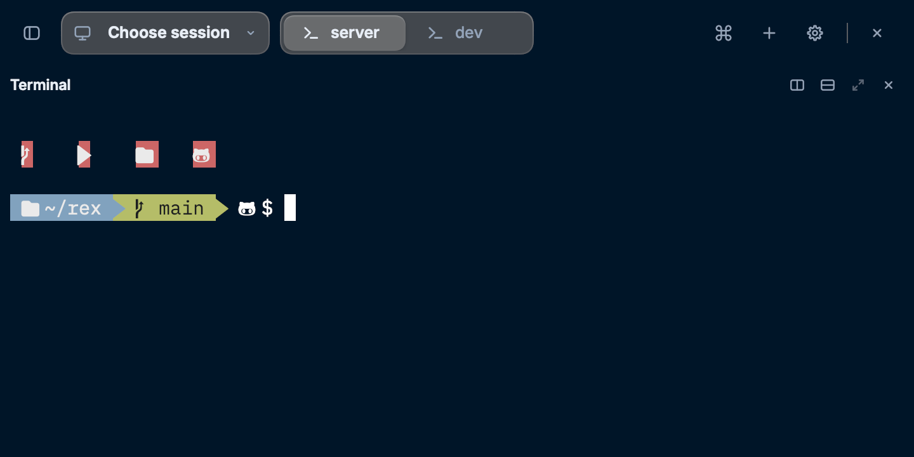
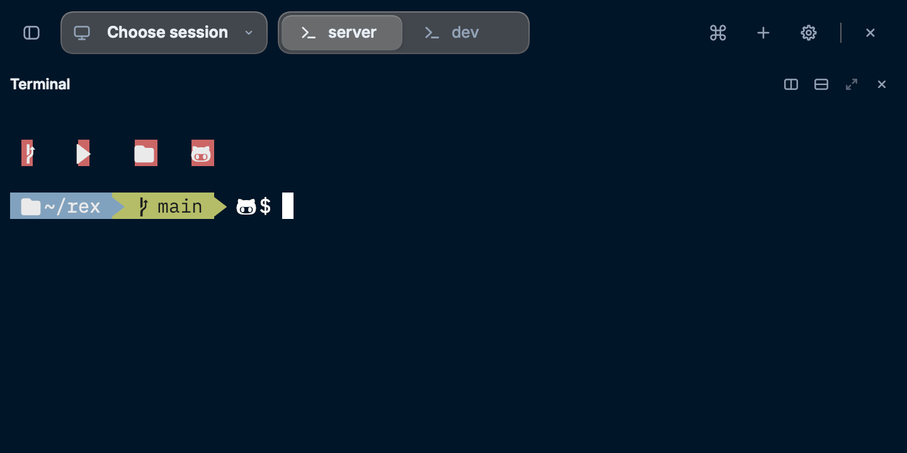
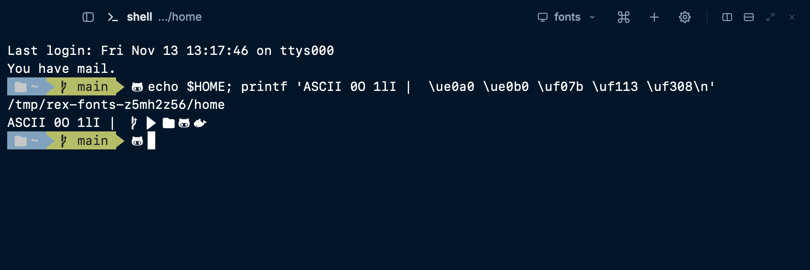
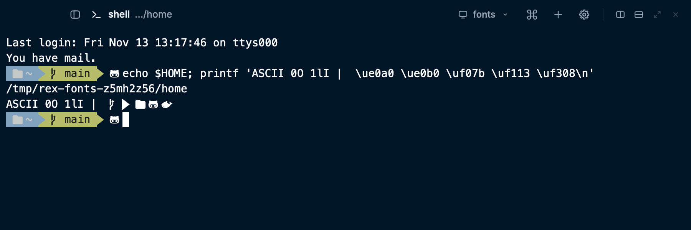
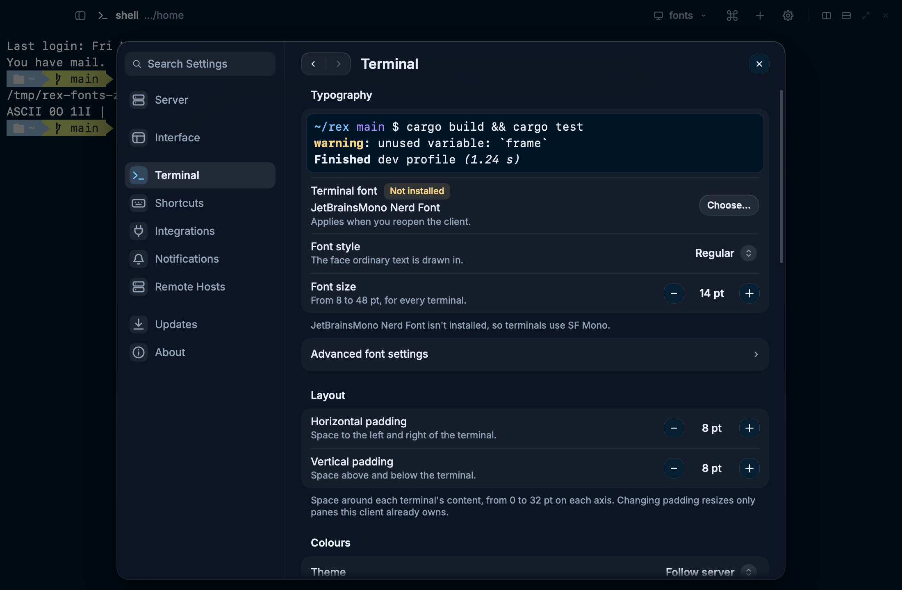
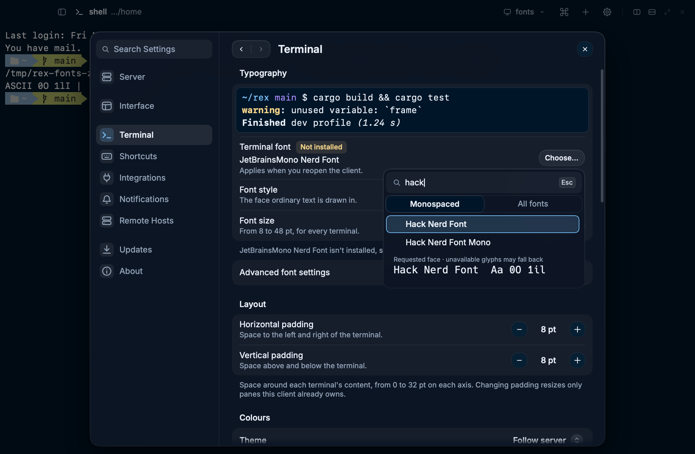

# M7 — terminal fonts without fontconfig, and bundled Nerd Font symbols

Implemented and checked on macOS 27 (Apple silicon), **2026-11-13 (PST)**. The built
client was run against a private Rex server with Homebrew off `PATH`. Linux and Windows
are covered by CI only (the Linux code path is unchanged; Windows runs the font tests
but no window has been looked at). Covers M7 and the part of W11 shared with it in
[the cross-platform plan](../plans/cross-platform.md).

## Shipped behaviour

- **One platform boundary**, `src/app/platform/fonts.rs`. Linux and the BSDs keep
  fontconfig (`fc-match` to resolve, `fc-list` to list) exactly as before. macOS and
  Windows use two functions a small Rune patch exposes (below), which read fontique's
  system collection: Core Text on macOS, DirectWrite on Windows. No call site outside
  the boundary has a platform `cfg`.
- **SF Mono** is listed and resolved under that name. macOS has it only under the
  hidden family name `.SF NS Mono`. Rune leaves dotted names out of the list, so the
  boundary adds SF Mono back and maps the name. The italic file, `SFNSMonoItalic.ttf`,
  says in its OS/2 table that it is upright, so the grid's upright text could come
  from either file (it did: one run drew the whole terminal in italic). The boundary
  therefore registers only `SFNSMono.ttf`, and program italics are slanted by Rune.
- **A missing primary family** uses the platform's own monospaced font: SF Mono,
  then Menlo, on macOS; Cascadia Mono, then Consolas, on Windows; then bundled IBM
  Plex Mono, as Linux always has. The saved family (`font_family`, initially
  `JetBrainsMono Nerd Font`) is never rewritten, so it is used again once installed.
  stderr says `Terminal font "JetBrainsMono Nerd Font" not found; using SF Mono.`
  and Settings → Terminal says `JetBrainsMono Nerd Font isn't installed, so terminals
  use SF Mono.` The Not installed chip's help gives the order. Neither text names
  fontconfig off Linux; Linux still does.
- **Monospaced** follows fontconfig's rule on every platform: every mapped character
  has one advance, or two where one is twice the other (dual-width CJK families),
  each within 1/33. A face that maps none falls back to its `post` table's flag. So
  a Nerd Font's `Propo` variant, whose icons have their own widths, is listed under
  All fonts only, as fontconfig lists it on Linux.
- **The catalog is read off the UI thread.** The picker asks for it the first time
  it opens; a `rex-fonts` thread reads it once and wakes the UI. Until then the list
  says "Reading installed fonts…". Resolving the launch family still happens on the
  main thread at startup (below).
- **Symbols Nerd Font 3.5.1** (`resources/fonts/`, from the upstream release archive,
  version and SHA-256 pinned, MIT license and the icon sets' licenses alongside) is
  compiled in. In the stack it comes after the named fallbacks and IBM Plex Mono and
  before the automatic system fallbacks:
  `'<primary>', '<fallbacks>…', 'IBM Plex Mono', 'Symbols Nerd Font'`. It is not added
  twice when named as a fallback. Prompts drawn for a Nerd Font get their branch,
  Powerline and file icons in any terminal font, on every platform.

## The Rune patch

`vendor/rune/crates/rune/src/text/system_fonts.rs` and `text.rs`, described in
`vendor/rune/README.md`:

- `text::installed_family_files(name)`, the lookup behind `Family::Named`, is public.
- `text::installed_families()` returns every installed family as
  `InstalledFamily { name, fixed_pitch }` by the rule above.
- Both share one system collection per thread instead of building one per call.

No other Rune behaviour changes.

## Which symbols file

The release has `SymbolsNerdFont-Regular.ttf` and `SymbolsNerdFontMono-Regular.ttf`.
The choice was made by rendering: `nerd_symbols_draw` draws each prompt glyph in white
on a red box and measures its ink against the cells Rex's grid gives it (IBM Plex Mono
15 pt; cell 9×21 pt; 2×).

| Glyph | Regular (chosen) | Mono |
| --- | --- | --- |
| U+E0A0 branch, 1 cell | x 0.000–0.667, y 0.190–0.905 | x 0.500–1.167: half a cell to the right, into the next cell |
| U+E0B0 Powerline arrow, 1 cell | x −0.111–1.056, y 0.167–0.905 | about the same |
| U+F07B folder, 2 cells | x 0.000–1.556, y 0.238–0.833 | |
| U+F113 GitHub, 2 cells | x 0.000–1.444, y 0.286–0.786 | |

Mono gives every glyph a 1 em advance (wider than a Plex cell) and centres it there.
Rex places a glyph whose advance is not exactly one cell at its column's left edge, so
the centring moves Mono's glyphs right. Regular draws from the left edge, as the grid
expects. The test keeps every glyph inside its cells, allowing the arrow's designed
overlap and one device pixel.

## Checks

`cargo fmt --all -- --check`, `cargo clippy --locked --all-targets --all-features -- -D
warnings`, `cargo test --locked --all-features` and `cargo build --locked --release --bin
rex-rune` pass on the Mac. Tests added:

- `app::fonts::tests`: the stack order, the symbols font not duplicated, the catalog
  merge (faces by name case aside, fixed-pitch only if every face is), the bundled
  families always listed, the off-thread read and its wake, the stand-in words.
- `nerd_glyphs_come_from_the_bundled_symbols_font_without_changing_ascii_cells`: U+E0A0,
  U+E0B0, U+F07B and U+F113 shape to real glyphs from the bundled file, ASCII comes from
  IBM Plex Mono, and the cell from `term::metrics` is the same with and without the
  symbols font in the stack.
- macOS: `sf_mono_is_the_system_font_under_its_hidden_name` (stack `.SF NS Mono`, the
  upright file only, Menlo found by `menlo`, unknown names not found) and
  `core_text_lists_and_resolves_families_without_fontconfig_on_path`, which re-runs
  itself with `PATH` empty, checks `fc-list` cannot run, and finds Menlo, SF Mono and
  IBM Plex Mono monospaced, Helvetica not, no dotted names, and Menlo resolving to
  `Menlo.ttc`.
- Linux: `missing_fontconfig_still_lists_bundled_families`, in a child with `PATH` empty.
- Windows: `direct_write_lists_and_resolves_the_system_families` (Consolas monospaced
  and resolving to `consola.ttf`, Arial not monospaced, a stand-in installed), run by a
  new step in the Windows CI job with a floor on how many font tests ran.
- `a_missing_terminal_font_names_the_platform_family_drawn_in_its_place`: the Settings
  footnote and chip help with a stand-in.

### On the Mac, as Finder starts it

`scripts/fonts-macos-private.py` runs the release binary with `PATH=/usr/bin:/bin`, its
own HOME and settings, against a private Rex server (the Rex Beta.app server binary, run
in place, with its own socket and state; stopped afterwards). Rex starts a login shell,
which would take the account's real HOME, so the session's shell is a wrapper that keeps
zsh on the private HOME. Everything is driven through Rune's `--script`, `--snap` and
`--tree`. Results on this Mac, which has Hack and the Meslo Nerd Fonts in their plain,
Mono and Propo variants:

| Check | Result |
| --- | --- |
| Default family missing | stderr `Terminal font "JetBrainsMono Nerd Font" not found; using SF Mono.`; Settings `JetBrainsMono Nerd Font isn't installed, so terminals use SF Mono.` with Not installed |
| `menlo`, Monospaced | Menlo |
| `sf mono`, Monospaced | SF Mono |
| `hack`, Monospaced | Hack Nerd Font, Hack Nerd Font Mono |
| `hack`, All fonts | Hack Nerd Font, Hack Nerd Font Mono, Hack Nerd Font Propo |
| `meslo`, Monospaced | the twelve MesloLG{L,M,S}{,DZ} Nerd Font and Nerd Font Mono families; no Propo |
| `helvetica`, Monospaced / All fonts | none / Helvetica, Helvetica Neue |
| Menlo chosen in the picker | saved as `"font_family": "Menlo"`; after reopening, no stderr notice, no Not installed chip or footnote, Settings shows Menlo |

The prompt is
`%K{blue}%F{white} \uf07b %1~ %F{blue}%K{green}\ue0b0%F{black} \ue0a0 main %k%F{green}\ue0b0%f \uf113`,
followed by a `printf` of the same glyphs and U+F308. In both fonts every glyph draws as
a glyph, not a box, and SF Mono is upright:

Before any of this, fontique's listing was compared with Homebrew's
`fc-list : family spacing` on the same Mac. With the rule above, the monospaced families
match fontconfig's except `GB18030 Bitmap`, which fontconfig does not list. Neither counts
Monaco or Courier as monospaced.

## Cost

Measured with a scratch program on fontique 0.12 and skrifa 0.44 (the versions in
`Cargo.lock`), 325 families:

| Step | Time |
| --- | --- |
| Core Text system scan, first after boot | about 220 ms |
| Core Text system scan, warm | 27–53 ms |
| Fixed-pitch check over every family | about 8 ms |

The catalog is above the 100 ms budget only cold, but it is read on its own thread
anyway. Resolving the launch family needs the same scan, once, on the main thread
before the first frame: about 20 ms warm, but the cold quarter-second would delay the
first launch after boot. The client's binary grows by about 2.5 MB on every platform
(the symbols font).

## Limits

- **Live family change (gap T07) is not part of this.** Family and fallback changes
  still apply after reopening the client.
- Wide icons such as the folder extend into the next cell and need the space after
  them that Nerd Font prompts already leave. Powerline separators are a little shorter
  than the row (y 0.167–0.905) and overlap their neighbours by about one point, by
  the font's design.
- The symbols font is a fallback for all text Rune draws, the chrome included. It can
  supply a character that the system's emoji font would otherwise draw: its Octicons
  include ⚡ (U+26A1) and ♥ (U+2665).
- SF Mono's italic comes from slanting the upright face, not from its italic file. That
  holds for the terminal grid; a picker or Settings sample of SF Mono, when another family
  is in use, loads the family through Rune's own lookup and may draw from the italic file.
- On macOS and Windows a family found in the system's list keeps the spelling it was asked
  for (`--font menlo` reports `menlo`), where fontconfig on Linux reports the installed
  name (`Menlo`).
- Windows: the fonts tests run in CI, but no window has been opened on Windows, and the
  stand-ins and catalog have not been looked at there.
- Linux: no change in behaviour; the Linux CI job is the only Linux run for this work.
  The symbols font is new on Linux too; the Linux packaging (`scripts/package-release.py`
  installs its license, the Nix source filter keeps it) is checked by CI.
