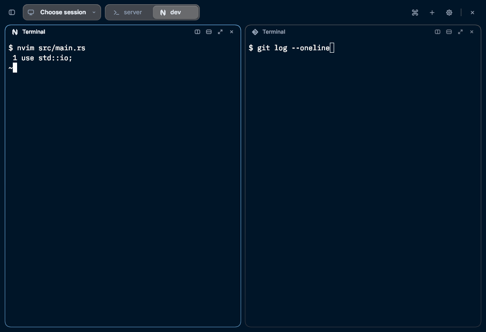
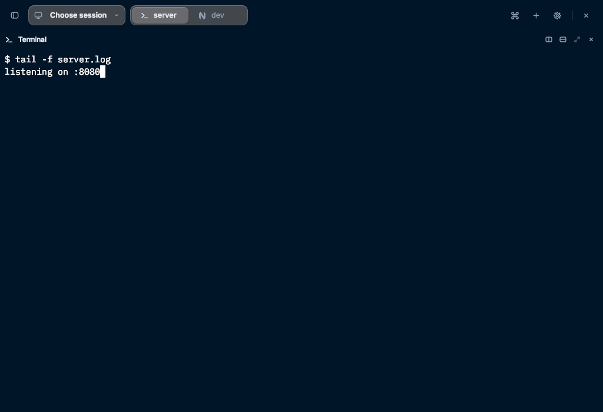
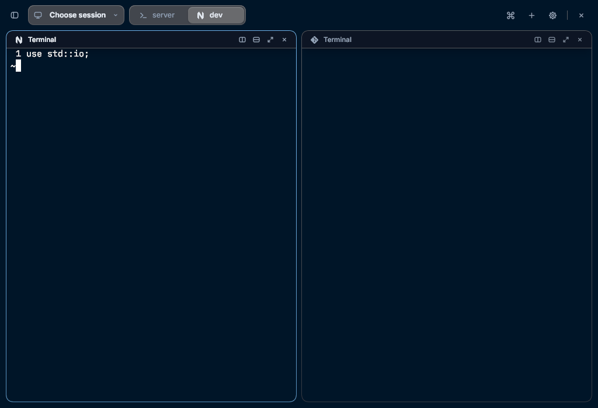
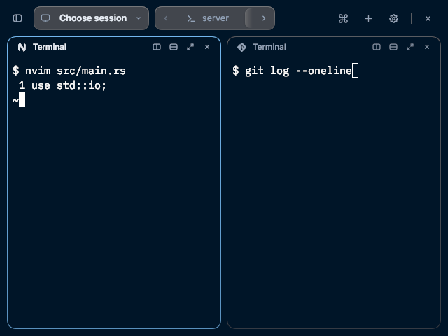

# Pane header program icon

PN02 in [gaps/d1-workspace-chrome.md](gaps/d1-workspace-chrome.md): the official Rex for macOS
draws each pane's program icon before its title in every pane header (`>_` + title 13 pt
regular, 22 pt buttons). Rex Rune drew the program glyph in toolbar tabs, in sidebar tab rows
and in the macOS title row, which is a lone pane's header there, but a pane header drawn by the
client (a split pane's card, a lone pane's Auto row, and a floating header) showed only its
name.

| Split panes, 1024×700 | A lone pane, edge to edge |
| --- | --- |
|  |  |

The first four are 1024×700 and the last 640×480, default settings, in the built headless
client with Inter and IBM Plex Mono. The two panes are `nvim` (Neovim's N) and `git` (its own
diamond), so a header showing its neighbour's glyph would be visible; the lone pane runs a
shell, whose glyph is the `>_` the official client draws for it too.

## What changed

- Every pane header draws that pane's own program glyph before its name: split panes, a carded
  single pane (Pane headers → Always), a lone pane's Auto row, the floating On hover header and
  one brought out by Reveal pane headers. It is `pane_header`'s placement that decides, so a
  header never gains or loses its glyph with anything but its own row.
- It uses the tabs' own path: `PaneProgram::of` for that pane's block (its deciding status
  record's app, then its foreground program), resolved by `program_icons`, and
  `tab_icons::append_restoring` for the cell, so the mapping, dedup, 15 pt slot at 13 pt and
  8 pt gap are the title row's. The cell carries the program's name as its tooltip, as a tab's
  does, and its glyph mixes back to its own resting colour while the header is hovered, as the
  name beside it does.
- **Show tab icons** governs it: `interface.tab_icon_count` 0 draws no glyph and leaves no gap;
  any count above 0 draws one, because a header has one pane to speak for rather than the tab's
  count. This is exactly what the macOS title row does (`…min(1)`).
- **Use colour for tab icons** applies with the tabs' rule. A header's glyph is lit with its
  pane (its pane has the keyboard: `INK`, otherwise `MUTED`, as its name is), so Active pane and
  Active tab tint a header only where its pane has the keyboard. See the limits below.
- Header fading multiplies only the glyph's own colour alpha, with the name: 0.85 when the pane
  is not focused (Fade inactive pane headers) or the window is not focused (Fade headers in
  inactive windows). Hovering the header, or the glyph itself, restores both, as it does the
  buttons' icons. The buttons keep their existing cues and the row itself is never faded.
- The glyph is given only the room the row will actually have. `pane_header::glyph_fits` adds
  up the header's leading pad and trailing pad, the 8 pt gap between every child, the 15 pt
  glyph, room for the name's first letters, the buttons the header draws (Split right and Split
  down join Zoom and Close from 200 pt wide) and what cannot shrink beside them: the activity
  word, reserved at about 6.2 pt a character, and the `Zoomed` chip. The progress bar is pinned
  across the row out of its flow and takes none. When that does not fit, the header keeps its
  name and buttons. So at 640×480 a 15% pane (about 89 pt) drops it, and so does a Blocked pane
  drawing “Needs you” at 25% (151 pt, two buttons) or 33% (200 pt, four buttons), where the row
  without the glyph still fits; the glyph never pushes Close past a pane's edge.
- Unchanged: the 30 pt row, the four buttons, the activity word, the Zoomed chip, the progress
  bar, the reconnect strip, name truncation (a long name still gives way first and keeps its
  whole text as the tooltip), the header's appearance rules, and the macOS title row, which
  already drew the glyph.

The terminal does not move: the header row's height and the pane rectangles are the same with
the glyph on or off. Nothing is sent to the server for any of this.

## Checks

- `cargo fmt --all -- --check`; `cargo clippy --locked --all-targets --all-features -- -D
  warnings`; `cargo test --locked --all-features` **1157 passed, 0 failed, 6 ignored**. This is
  shared code: it is compiled on Linux here, and macOS and Windows are left to CI; no OS `cfg`
  was added.
- `pane_header_icon_tests.rs` (new):
  - `split_headers_draw_their_own_panes_program_glyph`: each header's glyph names its own
    pane's program (Neovim against Git), is one 15 pt slot before the name, centred with it and
    inside its row, is `INK` on the pane with the keyboard and `MUTED` on the other, and under
    Active pane only the focused pane's is tinted.
  - `every_header_placement_draws_the_glyph_and_hidden_ones_do_not`: Auto and Always rows, a
    floating On hover header and one brought out by Reveal pane headers (on a Hidden pane too)
    draw it inside their own row; Hidden with nothing revealed draws no header and no glyph,
    and Compact's Auto is unchanged.
  - `tab_icon_count_governs_the_glyph_and_never_moves_the_grid`: counts 1, 0, 3, 0 and 1 leave
    every grid and header rectangle identical; 0 removes the glyph and its gap (the name moves
    back to the card's edge), and a header draws exactly one glyph cell, never the tab's count.
  - `a_narrow_header_keeps_its_buttons_and_drops_the_glyph`: a 15% pane at 640×480 has no
    glyph and its Close still ends inside the pane, while the wide pane keeps its glyph.
  - `an_activity_word_drops_the_glyph_before_it_pushes_close_out`: a Blocked record (“Needs
    you”) on a 25% and a 33% pane of a 640×480 split (about 151 pt, two buttons, and 200 pt,
    four) drops the glyph, keeps the whole word, and leaves Close inside the pane; with Show tab
    icons at 0 the same headers keep Close inside too, so the glyph never makes the row worse.
    Before this rule the glyph put Close's edge 23 pt outside the 151 pt pane.
  - `a_long_pane_name_truncates_between_its_glyph_and_its_buttons`: a 536-character name leaves
    the terminal grid where it was, is cut before Split right, keeps its whole text as the
    tooltip, and all four buttons and the glyph stay.
  - `pane_header_icon_draw_large` and `pane_header_icon_draw_minimum`: the captures above, run
    individually with `REX_TEST_SNAP_DIR`.
- Updated: `header_fading_tests.rs` treats the header glyph as a faded icon (with the name and
  the buttons' icons) rather than an unchangeable cue, and its hover test moves the pointer onto
  the glyph itself and expects it back at its resting colour; `pane_header_tests.rs` pins the lone
  pane's glyph at the terminal padding and its name 23 pt after, and
  `tab_icon_colour_tests.rs` excludes the header's glyph from the elements the colour choice
  must leave alone.

## Limits

- Only the focused pane's glyph is tinted under Active pane and Active tab. In tabs those modes
  ask whether the tab is on screen, and a header is always on screen; its tab-like "active"
  flag is the pane's own focus, which is also what decides `INK` or `MUTED`, as in the macOS
  title row. Nothing renders shell-provided icon themes; that remains deferred.
- The glyph's room is a client-side rule of ours, worked out from the row's own pads, gaps and
  buttons rather than something the official header was seen to do; the official evidence has
  one pane per window and no narrow split. Rune cannot measure text while the row is built, so
  the activity word is reserved at about 6.2 pt a character (from “Needs you” at 11 pt), which
  can be a few points generous or short for another word but never lets the glyph take Close's
  place.
- The glyph is the Shell `>_` for an unnamed or unknown program, as on its tab. A pane whose
  program has not been read yet therefore looks like a shell.
- Not verified: Wayland, a HiDPI display, a screen reader, macOS or Windows by hand. No native
  pointer script was re-run: they pin Pane headers → Hidden, so their grids are the terminal's,
  and this change moves no terminal.
