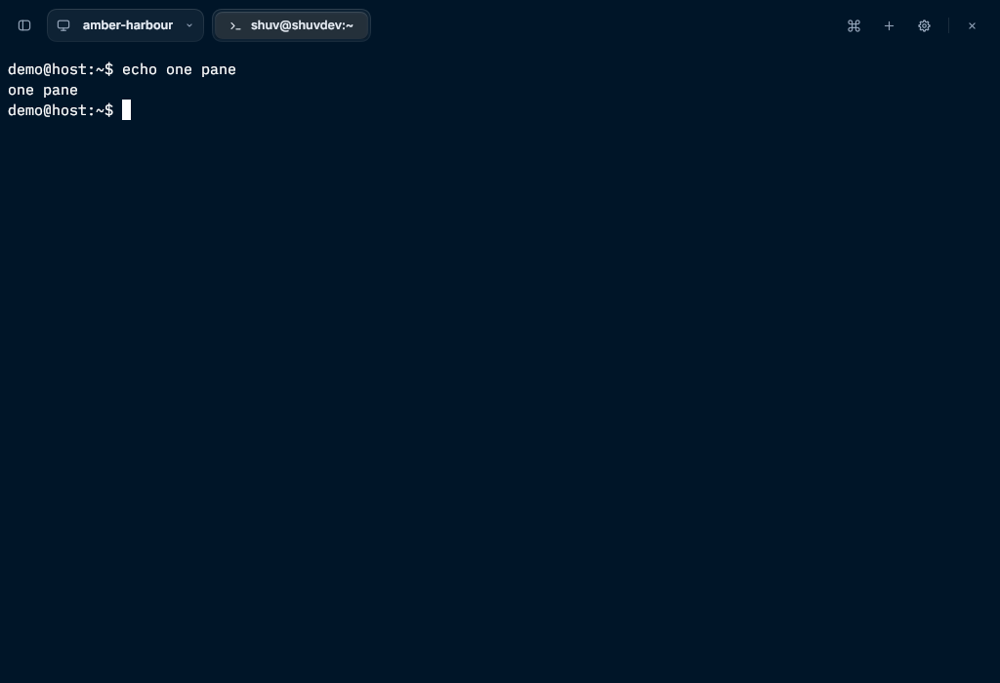
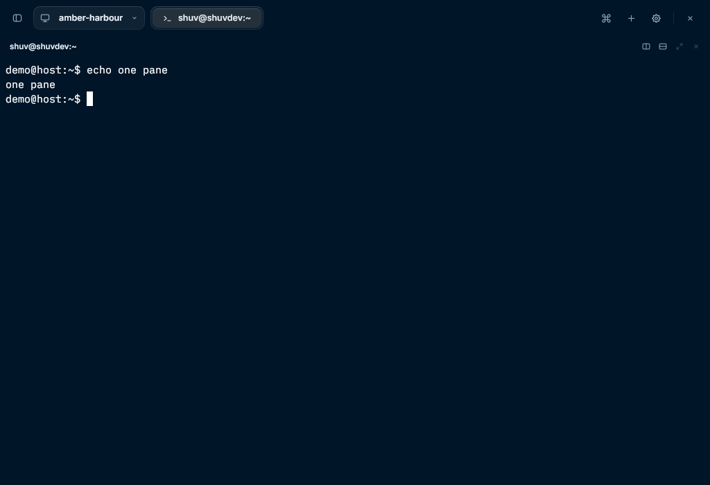

# Pane header on a single pane

Asked for by the owner on 2026-11-12 (PST): show Split right and Split down in the pane
header even when only one pane is open, as Rex for macOS does, and match which of its
controls are dimmed.

| Before | After |
| --- | --- |
|  |  |

Both are the built binary on a private Rex server under Xvfb, 1024×700, default settings,
one session with one tab and one pane. The pointer on Split right (headless capture, 2×):

## What Rex for macOS does

From the beta's accessibility tree (`rex-beta-ui-2026-11-10/evidence/089-…137-*.json`, one
tab with one pane in each) and the owner's screenshot: the lone pane has a 36 pt header
with its title at the left and five 22 pt buttons at the right, 24 pt apart: **Split
Right** and **Split Down** enabled; **Float Pane**, **Zoom Pane** and **Close Pane**
disabled (drawn dim).

## What changed here

- **Pane headers → Auto** (the default) now gives every pane a header row in Comfortable
  density, a lone pane included (`pane_header::rows`). Before, a lone pane had none.
- The lone pane keeps **no card and no margin**: it still fills the area edge to edge,
  and the header is a 30 pt row across its top. The terminal starts under it, so it has
  30 pt less height (one row at most sizes); a client that owns the pane's size resizes
  it as for any other change of geometry.
- The buttons are the four a split pane already has, same size, order, tooltips with
  shortcuts and hover fills: **Split right**, **Split down**, **Zoom** and **Close**.
  Rex Rune has no floating panes, so there is no Float button.
- **Zoom** is dim on the only pane of a tab, as before.
- **Close** is dim on the **last pane of a session** (one tab with one pane), with the
  tooltip "Close pane · the session's only pane", and does nothing when pressed. It is
  enabled for a single-pane tab when the session has other tabs.
- **Reveal pane headers** has nothing to bring out where every pane has a row, so it is
  unavailable in Auto with Comfortable density, as it already was in Always.

Unchanged: Compact density (no header rows in Auto), Always (a lone pane is a card with
its header), On hover and Hidden. **On hover or Hidden give the old look of a lone
pane.** No new setting.

## Two places this differs from macOS, on purpose

- **Close with other tabs open.** The beta evidence only shows a session with one tab,
  where Close is disabled. Rex Rune's tab pills have no close button, so a single-pane
  tab's header Close is the one visible way to close it with the pointer; it stays
  enabled unless the pane is the session's last.
- **Close elsewhere.** Only the header's button is dimmed. Close pane… in the pane menu
  and Commands, the shortcut, and Close tab in the tab's menu still close the session's
  last pane, behind the same confirmation as before. Zoom is different: it has nothing
  to do, so it is unavailable everywhere.

## Checks

- `cargo fmt --all -- --check`; `TMPDIR=/var/tmp cargo test --locked --all-features`
  (1040 passed, 0 failed, 6 ignored, on the branch merged with master at `aa8eac3`);
  `cargo clippy --locked --all-targets --all-features -- -D warnings`; release build.
- `auto_gives_a_single_pane_a_header_row_edge_to_edge_and_compact_none` replaces the test
  that pinned the old behaviour: the pane still fills the area, the header is a 30 pt row
  across its top, the grid starts under it, the four buttons sit 24 pt apart, Split down
  sends `session.new_split`, Zoom is dim, Close is enabled with a second tab and dim,
  inert and explained on the session's last pane while the pane menu still offers it,
  and Compact has no header on a single or a split tab.
- Eight tests assumed a lone pane had no header. Three had that as their subject and now
  assert the new layout; two (pane padding) had their expected rectangles moved down
  30 pt; two (toolbar Hidden / On hover leaving the top edge to the terminal) pin Pane
  headers → Hidden, which is what they are about; the Reveal test uses Compact for Auto.
- Real-font captures `header-auto-single`, `header-auto-single-split-hover` and
  `header-auto-last-pane` added to `pane_headers_draw_under_each_choice`
  (`REX_TEST_SNAP_DIR`), inspected.
- Native, each on its own private server under Xvfb, with the built binary:
  `terminal-selection-x11`, `pane-padding-x11`, `header-fading-x11`, `insert-path-x11`,
  `activity-list-x11`, `activity-chip-x11`, `server-settings-x11`,
  `notification-quality-x11`, `activity-sounds-x11` (fake players), `tab-fill-x11`,
  `tab-icons-x11`, `tab-icon-colours-x11`: all passed.

Scripts: pointer scripts compute cell positions from a pinned layout. `pin_layout` in
`rune-acceptance-x11.py`, `x11-smoke.py` and `pane-padding-x11.py` now also pin
`pane_header: "hidden"`, so their grid origin and sizes are the terminal's.
`insert-path-x11.py` pins it too: it reads whole-window captures by OCR, and the
header's line of text beside the browser changed how tesseract segmented the rows (it
passed on master and failed twice on this branch before the pin; the drawn browser was
correct in both).

## Not verified

- Wayland; a HiDPI display; a screen reader.
- `x11-smoke.py`, `rune-acceptance-x11.py`, `scroll-selection-x11.py` (needs `xclip`),
  `font-metrics-x11.py` and `clipboard-x11.py` were not run after the change; they use
  the pinned layout.
- The hover state natively: the pointer was moved over Split right under Xvfb and the
  capture did not change, so the hover image above is the headless one.
- Whether Rex for macOS disables Close on a single-pane tab when other tabs exist.

## Review (Cursor-pool Opus, on `78cc32b`)

It asked for one change before merge:

- **With the toolbar on Show on hover, the pane's Close sat under the toolbar's reveal
  edge.** The lone pane's header was the top 30 pt of the window, with Close at y 3 to
  27, and the toolbar comes out when the pointer rests in the top 8 pt. A pointer aimed
  at Close pane, or overshooting toward the corner, brought the toolbar out over it, with
  **Close app** where Close pane had been, and Close app asks nothing. Split right and
  Split down were covered the same way by Settings and Commands. Before this change no
  layout put a control inside that edge.

  Now, while the toolbar has no row of its own (Show on hover or Hidden), a lone pane's
  header sits 8 pt down (`pane_header::clearance`): clear of the reveal edge and of the
  window's 6 pt resize edge. `a_lone_panes_header_stays_clear_of_the_top_edge_when_the_toolbar_has_no_row`
  checks both toolbar modes with the default header: the header and its buttons start
  below the edge, resting on Close pane brings out no toolbar, a press there opens Close
  pane's confirmation and never a window action, a press where the sidebar button used
  to be is the header's, and the edge above the header still reveals the toolbar. With the clearance set to zero it fails on its first assertion (the header at y 0
  where y 8 is expected). This also restores default-layout coverage for the two toolbar tests that now pin headers
  Hidden.

Also from it:

- On an edge-to-edge pane the header's name now starts at the terminal's horizontal
  padding (8 pt at least) and lines up with the text under it; on a card it keeps 14 pt.
- The Pane headers helper reads "Auto shows them on every pane in Comfortable density."

After these changes: `cargo fmt --all -- --check`; `TMPDIR=/var/tmp cargo test --locked
--all-features` **1041 passed, 0 failed, 6 ignored**; strict clippy; release build; the
after capture above retaken; `terminal-selection-x11`, `pane-padding-x11`,
`header-fading-x11`, `insert-path-x11` and `activity-list-x11` passed again.

A focused re-check of that commit found it ready to merge and two stale lines in
DESIGN.md, corrected. It also noted two things that were already so before this change
and are left:

- With **Pane headers → On hover** and **Toolbar → Show on hover** together, a lone pane's
  floating header sits at the top of the window, so its Close is under the toolbar's
  reveal edge, as the row was before the fix above.
- With no toolbar row, the floating key-sequence or download chip at the top left covers
  the start of the header's name.

## Follow-ups not taken

- The dimmed Zoom and Close are still plain buttons to assistive technology, with no
  disabled state (the pattern Zoom already had).
- No native script clicks Split right on a default lone pane; the pointer scripts pin
  headers Hidden.
- With the toolbar Hidden or On hover, the lone pane's header is now the top row of the
  window, 38 pt in all. People who chose a hidden toolbar for the room may want Pane
  headers → Hidden as well; nothing sets that for them.
